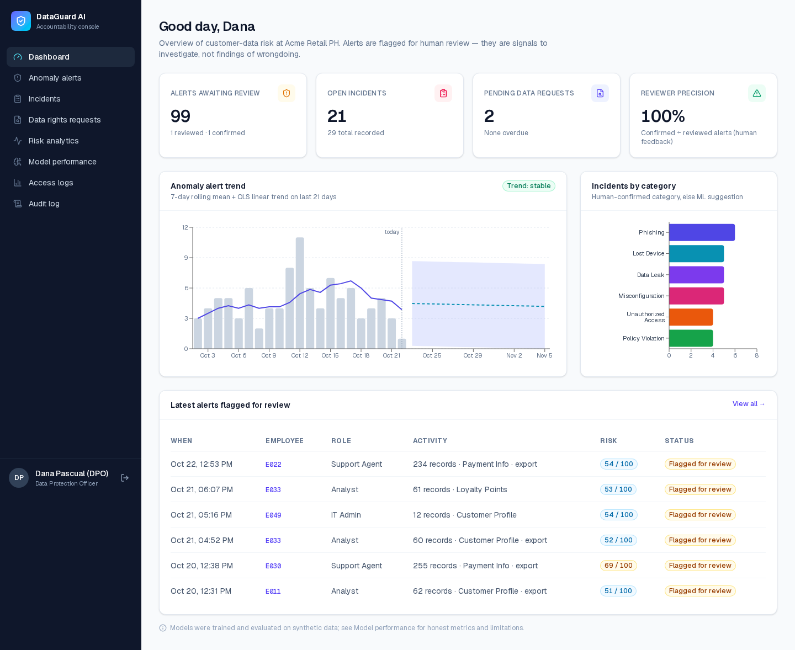
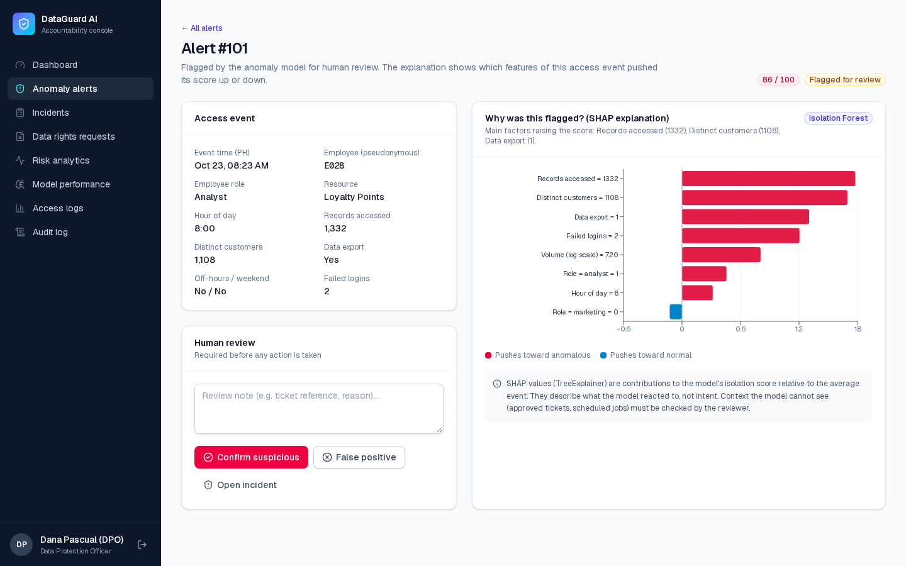
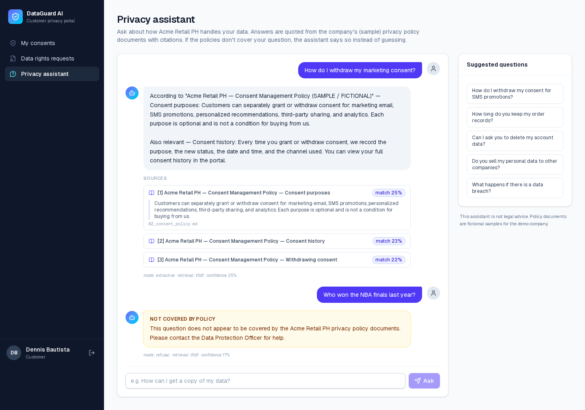
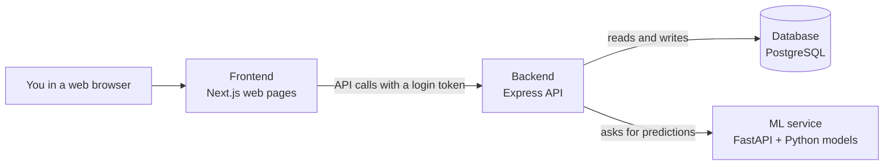

# DataGuard AI

**An Intelligent Customer Data Protection and Corporate Accountability System Using Machine Learning**

## What is this?

DataGuard AI is a working prototype of a privacy tool for a **made-up Philippine online store, "Acme Retail PH"**.
Customers use it to control how the store uses their personal data. The store's privacy and security
staff use it to spot employees who may be misusing customer data, manage incidents, and prove what
happened with a tamper-evident log. Machine learning (ML) helps by flagging suspicious activity,
explaining why, sorting incident reports, and answering customers' privacy questions from the store's
policy documents. It is a capstone / portfolio project, and **every person and record in it is fake**.

**Try it live:** https://dataguard-ai-roan.vercel.app

| Sign in as | Email | Password |
|---|---|---|
| Customer | `customer@dataguard.demo` | `DemoPass123!` |
| Data Protection Officer (DPO) | `dpo@dataguard.demo` | `DemoPass123!` |
| Security analyst | `security@dataguard.demo` | `DemoPass123!` |
| System admin | `admin@dataguard.demo` | `DemoPass123!` |
| Executive (read-only) | `exec@dataguard.demo` | `DemoPass123!` |

There is also a second customer, `customer2@dataguard.demo`, with the same password. These logins are
public and for demo only, so never reuse this password anywhere.

| DPO dashboard | Why an alert was raised (SHAP) | Privacy assistant |
|---|---|---|
|  |  |  |

> Looking for API endpoints, the database schema or the full ML methodology? See
> **[docs/TECHNICAL.md](docs/TECHNICAL.md)**.

## Contents

- [The problem it solves](#the-problem-it-solves)
- [How it works](#how-it-works)
- [Features](#features)
- [The machine learning, explained simply](#the-machine-learning-explained-simply)
- [Why synthetic data?](#why-synthetic-data)
- [Run it on your own computer](#run-it-on-your-own-computer)
- [Troubleshooting](#troubleshooting)
- [Project structure](#project-structure)
- [Deploying to Vercel](#deploying-to-vercel)
- [Limitations](#limitations)
- [Future work](#future-work)
- [Glossary](#glossary)
- [Credits](#credits)

## The problem it solves

When you buy something online, the store keeps your name, address, phone number and order history.
Many employees can open that data, and most of them need it for their work. But what if one employee
quietly exports thousands of customer records at 2 a.m.? Or a customer asks, "Please stop sending me
promo texts," and nobody can show it was done?

Companies need answers to three questions:

1. **Are customers in control?** Can they see and change their consents, and ask for a copy, a correction or deletion of their data?
2. **Is anyone misusing the data?** Out of thousands of normal look-ups every day, which few deserve a closer look?
3. **Can we prove it?** If something goes wrong, is there a record of who did what that nobody can secretly edit?

DataGuard AI is a small, working answer to all three.

## How it works



The app has four parts. Each one runs as its own program.

| Part | What it does | Built with |
|---|---|---|
| **Frontend** | The pages you see: the customer portal and the staff console. It never touches the database directly. | Next.js (React), TypeScript |
| **Backend** | The "front desk." It checks who you are and what your role allows, saves changes, writes the audit log, and asks the ML service for predictions. | Express (Node.js), TypeScript |
| **ML service** | The "analyst." It loads the trained models and answers questions like "how unusual is this event?" Only the backend can call it. | FastAPI (Python), scikit-learn, SHAP |
| **Database** | Where everything is stored: users, consents, requests, access logs, alerts, incidents and the audit log. | PostgreSQL |

A few terms you will meet right away:

- **API (Application Programming Interface):** a set of web addresses that programs use to talk to each other. For example, the frontend sends `POST /api/auth/login` with your email and password, and the backend replies.
- **JWT (JSON Web Token):** after you log in, the backend gives your browser a signed "digital ID card." The browser shows it on every request, so the backend knows who you are and what your role is, such as customer or DPO.
- **Role-based access control (RBAC):** each role can only do certain things. For example, a customer who tries to open the staff console is sent back to the portal, and the API refuses the request.
- **Hash chain:** every important action is added to an audit log with a short "fingerprint" (a SHA-256 hash) that also includes the previous row's fingerprint. If anyone edits an old row later, every link after it stops matching, and *Verify hash chain* spots the change.

What happens when an employee opens customer data:

1. The access event is saved in the database.
2. The backend sends it to the ML service, which gives it a **risk score** from 0 to 1.
3. If the score is 0.5 or higher (the default threshold), the backend creates an **alert** marked *flagged for review*.
4. A DPO or security analyst opens the alert, reads the explanation, and decides: *confirmed* or *false positive*.
5. Every decision is written to the **hash-chained audit log**.

## Features

| Feature | What it does, in plain words | Where in the code |
|---|---|---|
| Login and roles | Signs you in and limits each role to what it is allowed to do | `backend/src/routes/auth.ts`, `backend/src/lib/auth.ts` |
| Consent management | Customers switch each use of their data on or off (marketing email, SMS promos, and so on) and see the full history | `backend/src/routes/consents.ts`, `frontend/src/app/portal/consents` |
| Data-rights requests | Customers ask for a copy, a correction or deletion of their data; the DPO tracks and answers each request | `backend/src/routes/requests.ts`, `frontend/src/app/portal/requests`, `frontend/src/app/admin/requests` |
| Privacy assistant | Answers privacy questions by quoting the store's policy documents, and says "not covered" instead of guessing | `ml-service/app/rag.py`, `frontend/src/app/portal/assistant` |
| Anomaly alerts | Scores every employee access event and flags unusual ones for a person to review | `backend/src/jobs/scorer.ts`, `ml-service/app/main.py` |
| Alert explanations | Shows which details pushed the risk score up or down | `ml-service/app/main.py` (SHAP), `frontend/src/app/admin/alerts/[id]` |
| Simulate events | A button on *Access logs* that adds 5 fake access events and scores them on the spot, which is handy for live demos | `backend/src/routes/accessLogs.ts`, `frontend/src/app/admin/access-logs` |
| Incident management | Records incidents, suggests a category with ML, and tracks owners, status and corrective actions | `backend/src/routes/incidents.ts`, `frontend/src/app/admin/incidents` |
| Risk trend | Charts daily alerts or incidents with a 7-day average and a simple 14-day projection | `ml-service/app/forecast.py`, `frontend/src/app/admin/risk` |
| Model performance | Shows the models' test results honestly, including their mistakes | `ml-service/models/metrics.json`, `frontend/src/app/admin/models` |
| Audit log | Records every important action in a chain that reveals any later edit | `backend/src/lib/audit.ts`, `frontend/src/app/admin/audit` |
| Privacy in logs | Hides emails, phone numbers and tokens in server logs | `backend/src/lib/mask.ts` |
| User management | The admin creates staff accounts and changes roles | `backend/src/routes/users.ts`, `frontend/src/app/admin/users` |
| Demo mode | An optional frontend-only version with saved sample answers, so no server is needed | `frontend/src/lib/demo.ts`, `frontend/src/demo/fixtures.json` |

## The machine learning, explained simply

> All numbers below were measured on **synthetic (fake) data** made by `data/generate.py`. They show the
> system works end to end. They do **not** tell you how well it would work on a real company's data.

### 1. Spotting unusual data access (anomaly detection)

**Anomaly detection** means finding the few events that look very different from the rest. Nobody tells
the model which events are "bad"; it learns what normal looks like and flags what doesn't fit.

The model is an **Isolation Forest**. Picture playing "20 questions" to single out one event: "Was it
after 8 p.m.? Were more than 500 records opened?" A strange event gets isolated after only a few
questions, while a normal one needs many. The forest asks these random questions with 300 trees and
turns "isolated quickly" into a high risk score.

The model looks at the hour, the number of records and distinct customers opened, off-hours and weekend
flags, whether data was exported, failed logins, and the employee's role. It was trained on the first
60 days of fake logs and tested on the last 30 days: 2,718 events, of which 127 were planted anomalies.

| Measure | Result | What it means |
|---|---|---|
| Precision | **0.790** | When it raises an alert, it is right about 79 % of the time. |
| Recall | **0.890** | It catches about 89 % of the planted suspicious events (113 of 127). |
| F1 | **0.837** | One number that balances precision and recall (1.0 is perfect). |
| False-positive rate | **0.0116** | It wrongly flags about 1 in 86 normal events (30 of 2,591). |

It is best at off-hours bulk exports and credential misuse (recall 1.00 for both) and weakest at
"role mismatch" (0.72), because the model doesn't know which roles *should* see which data.

**SHAP (SHapley Additive exPlanations)** is a method that splits a prediction into "how much each
detail contributed." On every alert you see a bar chart. Red bars, such as *Records accessed = 1,332*,
pushed the score toward suspicious, and blue bars pushed it toward normal. This helps a person judge the
alert. It explains what the model reacted to, **not** what the employee intended.

### 2. Sorting incident reports (text classification)

When staff write an incident report, the system suggests one of 6 categories: unauthorized access,
data leak, phishing, misconfiguration, policy violation or lost device. The text is turned into numbers
with **TF-IDF** (explained below), and two models were compared on 180 test reports:

| Model | Accuracy | Macro F1 |
|---|---|---|
| Logistic Regression | 0.844 | 0.844 |
| Random Forest (used in the app) | **0.850** | **0.847** |

**Accuracy** is the share of reports put in the right category. **Macro F1** is the F1 score averaged
over the 6 categories, so small categories count as much as big ones. The two models are practically tied.
To keep the task realistic, 4 % of the training labels were deliberately made wrong. The suggestion is
advisory only, and a person confirms the final category.

### 3. Answering privacy questions (RAG)

**RAG (Retrieval-Augmented Generation)** means "first look up the relevant document, then answer from it."
This assistant **retrieves** the best-matching section of the 5 sample policy documents and quotes it with
a citation. It does not make up text.

- On the live site, matching uses **TF-IDF** (Term Frequency–Inverse Document Frequency). It scores words that are frequent in a section but rare elsewhere, such as "consent" or "retention," higher than common words.
- In the Docker version, it first tries a small embedding model (MiniLM + FAISS) that matches by meaning. If that isn't available, it falls back to TF-IDF automatically.
- If nothing matches well enough, or the question isn't about privacy (for example, "Who won the NBA finals?"), it answers that the question is **not covered by policy**.

For the full methodology, per-pattern results and the trend analysis, see [docs/TECHNICAL.md](docs/TECHNICAL.md#ml-methodology--evaluation).

## Why synthetic data?

**Synthetic data** is realistic-looking data generated by a program. Here, `data/generate.py` creates
400 fake customers, 60 fake employees, 90 days of access logs with planted suspicious events, and
900 incident reports. It uses a fixed random seed, so the results are the same every time.

We don't use real data because personal information is protected by law. In the Philippines, the
**Data Privacy Act of 2012 (Republic Act No. 10173)** requires a lawful basis, proper safeguards and
respect for people's rights over their data. A student project has no reason to handle real people's
records. Synthetic data lets us build and test everything safely. The policy documents in
`data/policies/` are fictional samples that mention the law only in general terms, and they are **not legal advice**.

## Run it on your own computer

The easiest way is **Docker**, which runs all four parts with one command.

### What you need

- **Git**, to download the code: https://git-scm.com/downloads
- **Docker Desktop**, to run everything: https://www.docker.com/products/docker-desktop/ (on Linux you can use Docker Engine with the Compose plugin instead)
- Optional, only if you want to run the parts without Docker:
  - **Node.js 20 or newer:** https://nodejs.org/
  - **Python 3.11 or newer:** https://www.python.org/downloads/
  - **PostgreSQL 14 or newer:** https://www.postgresql.org/download/

### Steps

1. **Open a terminal.** On Windows, use PowerShell or Git Bash. On macOS or Linux, use Terminal.
2. **Download the project:**
   ```bash
   git clone https://github.com/devA1drin/dataguard-ai.git
   cd dataguard-ai
   ```
3. **Create your settings file** by copying the example:
   ```bash
   cp .env.example .env
   ```
   On Windows PowerShell, use `copy .env.example .env`. Then open `.env` and change `JWT_SECRET` to any long random text.
4. **Start Docker Desktop** and wait until it says it is running.
5. **Build and start everything:**
   ```bash
   docker compose up --build
   ```
   The first run takes several minutes because it downloads the base images and Python packages (including PyTorch) and trains the models. Leave this terminal open.
6. **Open the app** at http://localhost:3000 and sign in with any demo account above.

What you should see:

| Address | What's there |
|---|---|
| http://localhost:3000 | The DataGuard AI login page |
| http://localhost:4000/api/health | `{"status":"ok","db":"ok","runtime":"server"}` |
| http://localhost:8000/docs | The ML service's interactive API page (Swagger UI) |

After start-up, the backend scores the roughly 1,900 seeded access events, which creates about 100 alerts.
A simulator then adds a fake access event every 20 seconds, so new alerts keep appearing.

- **To stop:** press `Ctrl + C` in the terminal.
- **To delete all data and start fresh:** run `docker compose down -v`.

> **Honest note:** the full Docker setup was tested end to end before the project was adapted for Vercel.
> Those changes touched the ML Dockerfile (its Python packages are now split into `requirements.txt` +
> `requirements-extras.txt`) and the backend entry files. The compose file still validates
> (`docker compose config`) and the backend still compiles, but a full `docker compose up --build`
> **has not been re-run since**, because Docker wasn't available on the machine used for those changes.
> If something fails, please open an issue.

To run each part without Docker, see [Running without Docker](docs/TECHNICAL.md#running-without-docker).

## Troubleshooting

| Problem | What to try |
|---|---|
| `Cannot connect to the Docker daemon` or `docker: command not found` | Start Docker Desktop and wait until it is running, then try again. On Linux, run `sudo systemctl start docker`, or add your user to the `docker` group. |
| `port is already allocated` / `address already in use` (3000, 4000, 8000 or 5432) | Another program is using that port, often a local PostgreSQL on 5432 or another dev server on 3000. Stop it, or change the left-hand number of that `ports:` line in `docker-compose.yml`, for example `"5433:5432"`. |
| `cp: command not found` on Windows | Use `copy .env.example .env` in PowerShell, or run the command in Git Bash. |
| The build stops while installing Python packages | Check your internet connection, then run `docker compose build --no-cache ml-service` and start again. |
| The page loads but login fails | Wait until the backend log says it is listening. It waits for the database and ML service to be healthy first. Check http://localhost:4000/api/health. |
| No alerts or empty charts | Give the backend a minute to score the seeded events, then refresh. |
| You want a clean start | Run `docker compose down -v`, then `docker compose up --build`. |

## Project structure

```
dataguard-ai/
├── frontend/          Web pages: customer portal (src/app/portal) and staff console (src/app/admin)
├── backend/           Express API: login, roles, routes, audit log, scoring job (src/)
├── ml-service/        Python ML service: API (app/), training scripts (training/), trained models (models/)
│   └── policies/      Copy of the policy documents bundled for the Vercel deployment
├── data/              Synthetic data generator (generate.py) and sample policy documents (policies/)
├── db/                Database schema (init.sql) and demo seed data (seed.sql, built by build_seed.py)
├── docs/              Technical reference (TECHNICAL.md) and screenshots
├── scripts/           Playwright scripts for screenshots and live end-to-end checks
├── docker-compose.yml Runs all four parts locally with Docker
├── vercel.json        Tells Vercel how to deploy the three services together
└── .env.example       Template for your local settings (copy to .env)
```

## Deploying to Vercel

The live site runs on **Vercel**, a hosting platform. One Vercel project hosts the frontend, the backend
and the ML service as three "services" listed in `vercel.json`. The database is a free **Neon Postgres**
database added from the Vercel Marketplace.

In short:

1. Install the Vercel CLI (`npm i -g vercel`), run `vercel login`, then run `vercel link` in the project folder.
2. Add a Neon Postgres database to the project from the Vercel dashboard (Storage → Marketplace). This sets `DATABASE_URL`.
3. Load `db/init.sql` and then `db/seed.sql` into that database.
4. Set these environment variables:
   - `JWT_SECRET` and `CRON_SECRET`: long random strings
   - `NEXT_PUBLIC_API_URL=/`
   - `NEXT_PUBLIC_ALERT_TRANSPORT=poll`
   - `NEXT_PUBLIC_DEMO_MODE=false`
   - `RAG_BACKEND=tfidf`
   - `SIMULATE_ACCESS_LOGS=false`
5. Run `vercel deploy --prod`.

On Vercel there are no always-running background jobs. Events are scored as they arrive, a daily scheduled
job (a Vercel Cron) scores anything left over, and the browser checks for new alerts every 15 seconds.
Full details are in [docs/TECHNICAL.md](docs/TECHNICAL.md#live-deployment-on-vercel).

## Limitations

- **Fake data, optimistic numbers.** The suspicious events were planted by the same program that defines "normal," so real misuse would be harder to catch.
- **Models don't learn over time.** Nothing retrains automatically or detects when behavior changes.
- **Simple trend line.** The risk projection is a straight-line fit, not a real forecast.
- **Small policy set.** The assistant knows only 5 short sample documents.
- **Prototype-level security.** There is no multi-factor login, password reset or login rate limit, and the token is kept in the browser's localStorage.
- **Audit chain limits.** The chain reveals edits, but a database superuser could rewrite the whole chain.
- **Requests are tracked, not executed.** Data-rights requests are tracked, but data is not exported or deleted automatically.
- **Few automated tests.** Checks are scripted API calls and browser runs; there are no unit tests yet.

The full list is in [docs/TECHNICAL.md](docs/TECHNICAL.md#limitations).

## Future work

- Use reviewers' decisions to tune the alert threshold, and retrain models regularly.
- Compare each employee with similar co-workers (peer-group baselines).
- Add multi-factor login, rate limiting and safer token storage.
- Automate data exports and deletions for data-rights requests.
- Add unit and integration tests that run automatically (CI).
- Grow the policy library and build a proper test set for the assistant.

## Glossary

| Term | Meaning |
|---|---|
| **Anomaly detection** | Finding the few items that look very different from the rest. |
| **API** | A set of web addresses that programs use to send requests and get answers. |
| **Audit log** | A record of who did what and when. |
| **Consent** | A customer's permission for a specific use of their data, such as marketing emails. |
| **Data Protection Officer (DPO)** | The person in a company responsible for privacy compliance. |
| **F1 score** | One number combining precision and recall; 1.0 is perfect. |
| **False positive** | An alert on something that was actually normal. |
| **Hash** | A short "fingerprint" of data (here SHA-256). Changing even one letter of the data changes the fingerprint completely. |
| **Hash chain** | Each audit entry's fingerprint also includes the previous entry's fingerprint, so editing an old entry breaks every link after it. *Verify hash chain* re-checks all links. |
| **Isolation Forest** | An anomaly-detection model that flags events that are easy to "isolate" with a few random yes/no questions. |
| **JWT** | A signed token the browser shows on each request to prove who is logged in. |
| **Machine learning (ML)** | Programs that learn patterns from example data instead of following hand-written rules. |
| **Precision** | Of the alerts raised, the share that were truly suspicious. |
| **RAG** | Retrieval-Augmented Generation: look up relevant documents first, then answer from them. |
| **Recall** | Of the truly suspicious events, the share that were caught. |
| **RBAC** | Role-based access control: permissions depend on your role. |
| **SHAP** | A method that shows how much each input detail pushed a prediction up or down. |
| **Synthetic data** | Realistic but fake data generated by a program. |
| **TF-IDF** | A way to turn text into numbers that gives more weight to distinctive words. |

## Credits

Built as a capstone / portfolio project. It uses open-source tools including Next.js, React, Express,
FastAPI, scikit-learn, SHAP, PostgreSQL and Playwright. All names, customers, employees and policies
are fictional. The project is hosted on Vercel with a Neon Postgres database.
