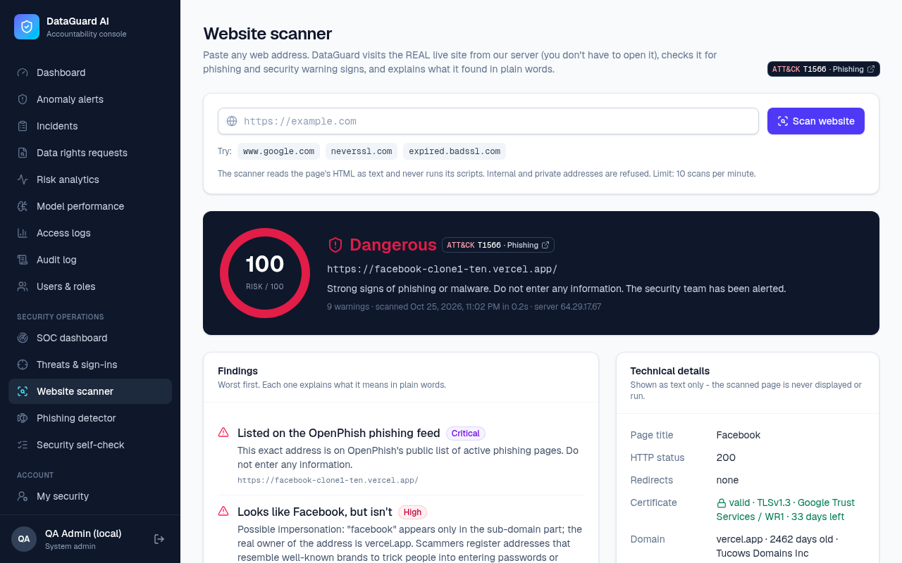
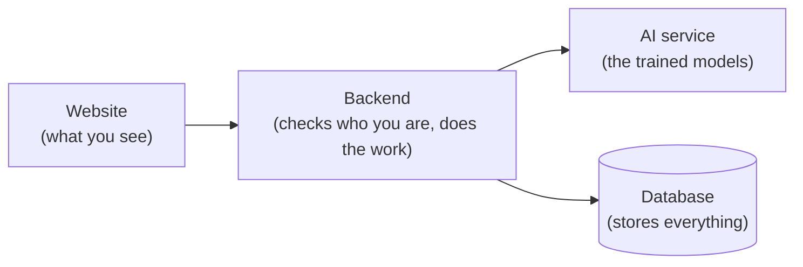

# DataGuard AI

## What is DataGuard AI?

DataGuard AI is a website that helps a company protect its customers' personal data.
It uses machine learning (AI that learns from examples) to spot staff who may be misusing data, and it watches the site for cyber attacks.
It also has a **Website Scanner** that checks any real website for signs of phishing.

**Live demo:** https://dataguard-ai-roan.vercel.app

Anyone can sign up for a free customer account. There are no shared demo passwords.

## What it can do

- **Website Scanner:** paste a link and get a safety score, a verdict (Safe, Suspicious or Dangerous) and the reasons in plain words. It checks the **real live website**, not fake data.
- **Your privacy controls:** customers choose how their data is used and can ask for a copy, a fix or deletion of it.
- **Privacy assistant:** answers privacy questions by quoting the company's policy, and says so when it doesn't know.
- **Unusual-access alerts:** AI flags staff who open customer data in odd ways, and shows why.
- **Incidents:** staff record problems, AI suggests a category, and a checklist guides the response.
- **Security center (SOC):** watches sign-ins for attacks and maps each alert to MITRE ATT&CK (a public list of hacker techniques).
- **Two-step sign-in (MFA):** an optional 6-digit code from a phone app.
- **Tamper-proof log:** every important action is recorded, and any later edit is detected.

## Screenshots

| Website Scanner | Security center (SOC) |
|---|---|
|  |  |

| Privacy officer dashboard | Privacy assistant |
|---|---|
|  |  |

## How it works



- **Website:** the pages in your browser.
- **Backend:** the "front desk". It signs you in, checks what you may do, and runs the Website Scanner.
- **AI service:** the "analyst". It scores events and links, and answers privacy questions.
- **Database:** where accounts, alerts, scans and the log are saved.

## Run it on your computer

You need [Git](https://git-scm.com/downloads) and [Docker Desktop](https://www.docker.com/products/docker-desktop/) (Docker runs all four parts for you).

1. Open a terminal.
2. Download the project:
   ```bash
   git clone https://github.com/devA1drin/dataguard-ai.git
   cd dataguard-ai
   ```
3. Copy the settings file: `cp .env.example .env` (on Windows: `copy .env.example .env`).
4. Open `.env`. Set `JWT_SECRET` to any long random text, and `ADMIN_EMAIL` to your own e-mail.
5. Start Docker Desktop, then run:
   ```bash
   docker compose up --build
   ```
   The first time takes several minutes.
6. Open http://localhost:3000 and sign up with your `ADMIN_EMAIL`. You become the admin.

To stop, press `Ctrl + C`. Running without Docker and fixing common problems are covered in [docs/TECHNICAL.md](docs/TECHNICAL.md).

## About the data

All customers, staff and access records are **synthetic** (made up by a program).
Real personal data is protected by the Philippine **Data Privacy Act of 2012 (RA 10173)**, so a student project should not use it.

The **Website Scanner is the exception**: it scans the real website you give it.
It only reads the page as text. It never runs the page's code, and it refuses private or internal addresses.

## Tech used

Next.js + Tailwind (website), Express + TypeScript (backend), FastAPI + scikit-learn (AI), PostgreSQL (database), hosted on Vercel.

## Learn more

Everything else (features in detail, the AI explained, security design, API, database, deployment, limitations and a glossary) is in **[docs/TECHNICAL.md](docs/TECHNICAL.md)**.
