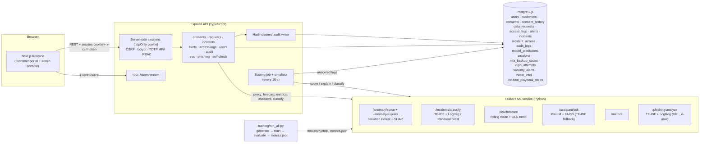
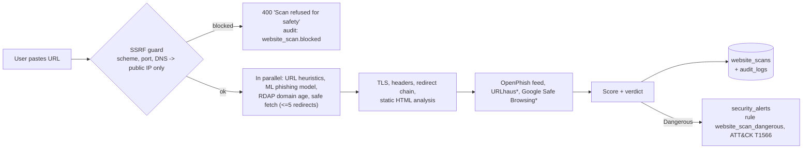
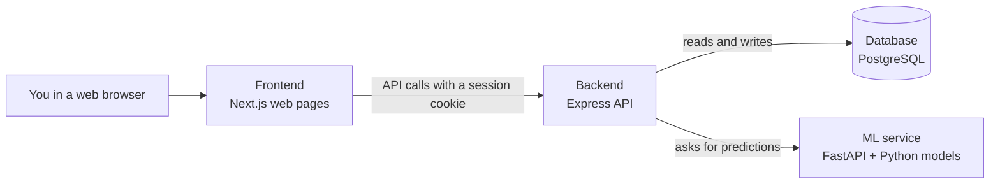

# DataGuard AI: technical reference

This page holds the detailed material for developers and reviewers. For the beginner-friendly
overview, start with the [main README](../README.md).

- [Features](#features)
- [Architecture](#architecture)
- [Quick start (Docker)](#quick-start-docker)
- [Running without Docker](#running-without-docker)
- [Live deployment on Vercel](#live-deployment-on-vercel)
- [Demo mode / Vercel](#demo-mode--vercel)
- [Accounts and the first admin](#accounts-and-the-first-admin)
- [Environment variables](#environment-variables)
- [Feature → code map](#feature--code-map)
- [ML methodology & evaluation](#ml-methodology--evaluation)
- [Cybersecurity module](#cybersecurity-module)
- [Website Scanner](#website-scanner)
- [API reference](#api-reference)
- [Database schema](#database-schema)
- [Security & privacy design](#security--privacy-design)
- [Ethical considerations](#ethical-considerations)
- [Limitations](#limitations)
- [Future work](#future-work)
- [How this MVP was verified](#how-this-mvp-was-verified)
- [Beginner guide (moved from the README)](#beginner-guide-moved-from-the-readme)

## Features

**Customer portal**
- View, grant and withdraw consent for each processing purpose, with a full consent history
- Submit access, correction and deletion requests and track them (reference number, status, target date, response)
- Privacy assistant: retrieval over the company policy docs. It answers with quoted passages and
  citations, and says *"not covered by policy"* when retrieval confidence is low

**Admin / DPO console**
- Dashboard KPIs, an anomaly trend chart, incidents by category and the latest flagged alerts
- Access-log anomaly alerts (Isolation Forest) with **per-event SHAP explanations**. Every alert
  starts as *flagged for review*, and only a person can mark it *confirmed* or *false positive*
- Incidents: an ML category suggestion (two models compared), assignment, status, severity, a
  human-confirmed category, notes and trackable corrective actions, plus a timeline
- Data-rights request handling. The response is shown to the customer; the internal note is not
- Risk analytics: daily counts, a 7-day rolling mean and a linear trend projected 14 days ahead with a band
- Model performance: precision, recall, F1, false-positive rate, ROC-AUC, confusion matrices, a
  comparison of the two classifiers and recall per anomaly pattern
- Audit-log viewer with **hash-chain verification**
- User and role management with a permission matrix; unlock and delete accounts
- **Security operations (security, DPO, admin):** SOC dashboard with posture score, sign-in threat
  monitoring with detection rules and a SAMPLE threat-intel list, MITRE ATT&CK badges, phishing
  detector, incident playbooks with the NPC 72-hour clock, and a security self-check of the site's headers

**Every account: Website Scanner** ([details](#website-scanner))
- Paste a URL; the backend scans the **real live site** (SSRF-guarded, static HTML only) and returns a 0–100
  risk score, a Safe / Suspicious / Dangerous verdict and plain-English findings. Customers see their own
  scan history, staff see everyone's; Dangerous results raise a T1566 alert in the SOC

**Every account: My security**
- Optional TOTP MFA (QR code + 10 one-time backup codes), password change, active sessions with
  "sign out other sessions", and personal sign-in history
- Real-time alerts: the backend scores new access events as they arrive and pushes new alerts to
  the console over Server-Sent Events

## Architecture



The browser never calls the ML service directly. Every ML call goes through the backend, which
checks authentication and role first.

```
dataguard-ai/
├── data/            generate.py (synthetic data) · policies/*.md (sample policy docs)
├── db/              init.sql (schema, append-only trigger) · build_seed.py → seed.sql
├── ml-service/      app/ (FastAPI) · training/ (train + evaluate) · models/ (generated)
├── backend/         src/ (Express + TS: routes, lib/audit.ts, lib/mask.ts, jobs/scorer.ts)
├── frontend/        src/app (pages) · src/lib (api, demo store) · src/demo/fixtures.json
├── docker-compose.yml · .env.example
```

## Quick start (Docker)

```bash
cp .env.example .env        # change JWT_SECRET, set ADMIN_EMAIL to your e-mail
docker compose up --build
# open http://localhost:3000/signup and sign up with ADMIN_EMAIL -> you are the first admin
```

| Service | URL |
|---|---|
| Frontend | http://localhost:3000 |
| Backend API | http://localhost:4000/api/health |
| ML service (Swagger UI) | http://localhost:8000/docs |
| PostgreSQL | localhost:5432 (dataguard / dataguard) |

What happens when the stack starts:
- The ML image generates the synthetic data, then trains and evaluates the models during `docker build` (about 10 s). It also tries to cache the MiniLM embedding model.
- Postgres runs `db/init.sql`, `db/seed.sql`, then the migrations in `db/migrations/` (002 security tables, 003 synthetic sign-in history + SAMPLE threat intel, 004 removes the old demo logins). There are **no login accounts** afterwards. Seed timestamps are relative to load time, so the data always looks recent.
- The backend scores the roughly 1,900 seeded access events through the ML service, which creates about 100 alerts. It also classifies the seeded incidents. A simulator then adds a synthetic access event every 20 s (set `SIMULATE_ACCESS_LOGS=false` to turn it off).

To reset everything, run `docker compose down -v`.

## Running without Docker

You need Python 3.11+, Node 20+ and PostgreSQL 14+.

```bash
# 1) ML: data + training + API
cd ml-service
python -m venv .venv && . .venv/bin/activate
pip install --index-url https://download.pytorch.org/whl/cpu torch   # optional, smaller CPU build
pip install -r requirements.txt -r requirements-extras.txt   # extras: uvicorn, MiniLM+FAISS (optional)
python -m training.run_all          # runs data/generate.py, trains, writes models/metrics.json
uvicorn app.main:app --port 8000

# 2) Database
createuser dataguard -P   # password: dataguard
createdb -O dataguard dataguard
python ../db/build_seed.py          # optional: regenerate seed.sql from data/generated
psql -U dataguard -h localhost dataguard -f ../db/init.sql -f ../db/seed.sql
for f in ../db/migrations/00*.sql; do psql -U dataguard -h localhost dataguard -v ON_ERROR_STOP=1 -f "$f"; done

# 3) Backend
cd ../backend && npm install && npm run build && npm start      # :4000
npm run create-admin                                            # first admin (or use ADMIN_EMAIL + sign-up)

# 4) Frontend
cd ../frontend && npm install && npm run build && npm start      # :3000
```

Useful commands:
- `npm run verify-audit` (in backend/) recomputes the whole audit hash chain from the command line.
- `RAG_BACKEND=tfidf` forces the TF-IDF retriever, which needs no model download.

## Live deployment on Vercel

**Live app:** https://dataguard-ai-roan.vercel.app. This is the full stack, not demo mode. Customers sign up on `/signup`; staff accounts are created by an admin.

The root `vercel.json` deploys three [Vercel Services](https://vercel.com/docs/services) together as one atomic deployment:

| Service | Root | Runtime | Public route |
|---|---|---|---|
| `frontend` | `frontend/` | Next.js | `/*` |
| `backend` | `backend/` | Express as a Vercel Function (entrypoint `src/app.ts`) | `/api/*` |
| `ml` | `ml-service/` | FastAPI as a Python Function (entrypoint `app/main.py`) | **none.** It is private and reachable only through a service binding (`ML_SERVICE_URL`) from the backend. |

The database is **Neon Postgres** (Vercel Marketplace, free plan). The integration provides `DATABASE_URL`, the pooled connection with SSL. Schema and seed are the same `db/init.sql` and `db/seed.sql` used by Docker, followed by the additive migrations in `db/migrations/` (each is idempotent: `IF NOT EXISTS` / `ON CONFLICT`).

How the serverless deployment differs from `docker compose`:
- **Scoring.** There are no in-process timers. Events are scored immediately on `POST /api/access-logs/ingest` and on `POST /api/access-logs/simulate` (the *Simulate 5 events* button on *Access logs*). Anything left unscored is handled by `GET /api/cron/score`, which a daily Vercel Cron calls with `Authorization: Bearer $CRON_SECRET`. Security and admin users can also call it with their session.
- **Live alerts.** The browser polls `GET /api/alerts/latest` every 15 s (`NEXT_PUBLIC_ALERT_TRANSPORT=poll`) instead of using SSE. SSE remains the default for Docker.
- **ML service.** It is stateless. It loads the trained `models/*.joblib` artifacts that are bundled with the deployment, so train them before deploying (`python -m training.run_all`). The assistant uses TF-IDF retrieval (`RAG_BACKEND=tfidf`) over the policy documents copied to `ml-service/policies/`. Off-topic questions are refused. `sentence-transformers`, `faiss`, `torch` and `uvicorn` live in `requirements-extras.txt`, which only the Docker image installs. This keeps the Python function at about 250 MB.
- **Configuration.** `JWT_SECRET` (signs CSRF tokens, derives the MFA encryption key unless `MFA_ENC_KEY` is set) and `CRON_SECRET` are random secrets stored as Vercel environment variables. The backend refuses to start on Vercel without `JWT_SECRET`. `ADMIN_EMAIL` bootstraps the first admin. On Vercel, cookies are `Secure` with the `__Host-` prefix and `trust proxy` is on. Other settings: `NEXT_PUBLIC_API_URL=/` (same origin), `NEXT_PUBLIC_DEMO_MODE=false`, `SIMULATE_ACCESS_LOGS=false`.

Deploy from the repository root with an authenticated Vercel CLI:

```bash
vercel link              # once
vercel deploy --prod
```

Verify a deployment end-to-end, including logins, scoring, SHAP, review, assistant, audit chain and RBAC, with 1440px screenshots:

```bash
DG_ADMIN_EMAIL=you@example.com DG_ADMIN_PASSWORD='...' DG_ADMIN_TOTP_SECRET='...' \
  python scripts/verify_live.py https://dataguard-ai-roan.vercel.app screenshots/live
```

It signs up a throwaway customer (`verify.<timestamp>@example.com`, printed at the end; delete it
under *Users & roles*) and signs in with your admin. The TOTP secret is only needed if that admin uses MFA.

Plan notes: the Hobby plan limits crons to once per day and functions to 300 s. Neon's free plan auto-suspends when idle, so the first request after a pause takes about 1 s longer.

## Demo mode / Vercel

The frontend can run on its own using bundled fixtures. These are real outputs exported from the
running stack: anomaly scores with SHAP values, incident classifications, the risk forecast, model
metrics and pre-computed assistant answers with citations.

```bash
cd frontend
NEXT_PUBLIC_DEMO_MODE=true npm run build && npm start
```

How demo mode behaves:
- **Login:** a role picker replaces the login form.
- **Banner:** a yellow *"Demo mode, sample data"* banner is always visible.
- **Changes:** consent toggles, requests, reviews, incident edits and user changes are saved only in your browser (localStorage). They are still written to a client-side audit chain using the same SHA-256 algorithm, so *Verify hash chain* works.
- **Assistant:** it cannot run the embedding model in the browser. It matches your question to the closest pre-computed one and refuses when nothing is close enough.

**Static demo on Vercel:** create a project with Root Directory `frontend` and set `NEXT_PUBLIC_DEMO_MODE=true`. Nothing else is needed. The live deployment described above does **not** use demo mode.

## Accounts and the first admin

There are **no seeded login accounts and no shared password**. Migration `004_remove_demo_accounts.sql`
deletes the old `*@dataguard.demo` users (their audit history stays; references are set to NULL).

- **Customers** sign up at `/signup` (`POST /api/auth/signup`). Sign-up always creates a `customer`
  user plus a new customer record with every consent off. An e-mail that already belongs to a
  synthetic customer record or a user is refused with 409. Sign-ups are limited per IP per hour.
- **Staff can't self-register.** An admin creates staff under *Users & roles* (`POST /api/users`,
  roles dpo / security / admin / executive only). Customers can't be turned into staff or the reverse.
- **First admin**, two ways:
  1. `ADMIN_EMAIL=you@example.com`: while **no admin exists**, a sign-up with exactly that e-mail
     becomes `admin` (audited as `auth.bootstrap_admin`). After that the variable has no effect.
  2. `npm run create-admin [-- email]` in `backend/` (or `npm run create-admin:prod` from a build /
     `docker compose exec backend npm run create-admin:prod`). Asks for name and a hidden password,
     applies the same password policy, creates or promotes the user, and writes `user.create_admin_cli`
     to the audit log. Works with piped input too.
- **E-mail verification and password-reset e-mails are not implemented**: they need an e-mail
  provider, and none is available for free in this deployment. This is a known gap.
- **Demo mode** (frontend only, `NEXT_PUBLIC_DEMO_MODE=true`) still has a role picker. It has no
  credentials at all, because nothing leaves the browser.

## Environment variables

Backend (see `.env.example`):

| Variable | Default | Purpose |
|---|---|---|
| `DATABASE_URL` | local postgres | Postgres connection |
| `JWT_SECRET` | dev default (refused on Vercel) | HMAC key for CSRF tokens; MFA key derivation |
| `MFA_ENC_KEY` | derived from `JWT_SECRET` | Separate AES-256-GCM key for TOTP secrets at rest |
| `ADMIN_EMAIL` | empty | First-admin bootstrap via sign-up |
| `SESSION_HOURS` | 8 | Session lifetime (cookie and server row) |
| `LOCK_THRESHOLD` / `LOCK_MINUTES` | 5 / 10 | Account lockout after N consecutive failures |
| `LOGIN_IP_FAIL_LIMIT` | 20 | Max failed sign-ins per IP per 15 min (429 after) |
| `COOKIE_SECURE` | true on Vercel, else false | `Secure` + `__Host-` cookie prefix |
| `TRUST_PROXY` | `true` on Vercel, else `loopback` | Express trust proxy (so `X-Forwarded-For` can't be spoofed) |
| `CORS_ORIGIN` | `http://localhost:3000` | Allowed browser origins (comma-separated, credentials on) |
| `URLHAUS_AUTH_KEY`, `GSB_API_KEY`, `SCAN_RATE_LIMIT`, `SCANNER_DOH_URL` | unset / 10 | Website Scanner options, see [Website Scanner](#optional-keys) |
| `SELF_CHECK_URL` | this deployment | Comma-separated URLs the self-check may scan (allow-list, no SSRF) |
| `ML_SERVICE_URL`, `ALERT_THRESHOLD`, `SIMULATE_*`, `CRON_SECRET` | | as before |

Frontend: `NEXT_PUBLIC_API_URL` (`/` for same origin), `NEXT_PUBLIC_ALERT_TRANSPORT` (`poll` or SSE),
`NEXT_PUBLIC_DEMO_MODE`, and optional `API_PROXY_URL` (build-time rewrite of `/api/*` to a backend,
useful for local same-origin testing).

## Feature → code map

| Feature | Where |
|---|---|
| Synthetic data (customers, consents, access logs with labelled anomalies, incident texts) | `data/generate.py` |
| Sample privacy policies | `data/policies/*.md` |
| Schema (11 tables) + append-only trigger | `db/init.sql` |
| Seed (demo users with bcrypt hashes, recent logs, incidents, requests) | `db/build_seed.py` → `db/seed.sql` |
| Sessions, CSRF, lockout, RBAC guards | `backend/src/routes/auth.ts`, `backend/src/lib/auth.ts` |
| Password policy (zxcvbn ≥ 3, 12+ chars) | `backend/src/lib/password.ts`, `frontend/src/components/security.tsx` |
| TOTP MFA + backup codes, AES-GCM at rest | `backend/src/lib/totp.ts`, `backend/src/lib/crypto.ts`, `frontend/src/components/MySecurity.tsx` |
| Sign-up + first-admin bootstrap | `POST /api/auth/signup`, `backend/src/scripts/createAdmin.ts`, `frontend/src/app/signup` |
| Detection rules + SAMPLE threat intel | `backend/src/lib/detect.ts`, `db/build_security_seed.py` → `db/migrations/003_security_seed.sql` |
| SOC dashboard, threats, feed, simulator | `backend/src/routes/soc.ts`, `frontend/src/app/admin/soc`, `frontend/src/app/admin/threats` |
| Phishing detector | `ml-service/training/train_phishing.py`, `ml-service/app/phishing_features.py`, `backend/src/routes/phishing.ts`, `frontend/src/app/admin/phishing` |
| IR playbooks + NPC 72-h clock | `backend/src/lib/playbooks.ts`, `backend/src/routes/incidents.ts`, `frontend/src/components/Playbook.tsx` |
| ATT&CK mapping | `frontend/src/lib/attack.ts` |
| Security self-check | `backend/src/routes/selfcheck.ts`, `frontend/src/app/admin/self-check` |
| Security headers / CSP | `backend/src/app.ts` (helmet), `frontend/src/proxy.ts` (per-request nonce CSP) |
| Consents + history | `backend/src/routes/consents.ts`, `frontend/src/app/portal/consents` |
| Data-rights requests (customer + DPO) | `backend/src/routes/requests.ts`, `frontend/src/app/portal/requests`, `frontend/src/app/admin/requests` |
| Privacy assistant (RAG, citations, refusal) | `ml-service/app/rag.py`, `frontend/src/app/portal/assistant` |
| Access-log scoring job, alert creation, simulator | `backend/src/jobs/scorer.ts` |
| Ingestion endpoint (score on arrival) | `POST /api/access-logs/ingest` in `backend/src/routes/accessLogs.ts` |
| Real-time alert push (SSE) | `backend/src/routes/alerts.ts` (`/stream`), `frontend/src/components/AppShell.tsx` |
| Human review of alerts | `PATCH /api/alerts/:id/review`, `frontend/src/app/admin/alerts/[id]` |
| Isolation Forest + SHAP | `ml-service/training/train_anomaly.py`, `ml-service/app/main.py` |
| Shared feature engineering | `ml-service/app/features.py` |
| Incident classifiers (LogReg vs RF) | `ml-service/training/train_incidents.py` |
| Incidents: assignment, status, notes, corrective actions | `backend/src/routes/incidents.ts`, `frontend/src/app/admin/incidents/[id]` |
| Risk trend | `ml-service/app/forecast.py`, `backend/src/routes/analytics.ts`, `frontend/src/app/admin/risk` |
| Model metrics | `ml-service/models/metrics.json` (generated), `frontend/src/app/admin/models` |
| Hash-chained audit log + verification | `backend/src/lib/audit.ts`, `backend/src/routes/audit.ts`, `frontend/src/app/admin/audit` |
| PII masking in logs and audit details | `backend/src/lib/mask.ts` |
| Data minimization in customer responses | explicit column lists in `consents.ts` / `requests.ts` |
| Users & roles | `backend/src/routes/users.ts`, `frontend/src/app/admin/users` |
| Demo mode | `frontend/src/lib/demo.ts`, `frontend/src/demo/fixtures.json`, `frontend/scripts/export-demo-fixtures.mjs` |

## ML methodology & evaluation

From `ml-service/`, run `python -m training.run_all` to reproduce these numbers. The seed is fixed at 42 and
`models/metrics.json` is regenerated on each run. **All numbers are on synthetic data.**

### 1. Access-log anomaly detection: Isolation Forest

- **Features** (`app/features.py`):
  - hour of day, records accessed, distinct customers, off-hours flag, weekend flag, export flag, failed logins
  - log(records), the distinct-customer ratio, and one-hot employee role
- **Training:** unsupervised. The `is_anomaly` labels are **never** used for fitting.
  - `IsolationForest(n_estimators=300, contamination=0.05)`
- **Split:** chronological. The first 60 days are used for fitting (5,473 events) and the last 30 days for evaluation (2,718 events, 4.7 % injected anomalies).
- **Score:** the risk score is `sigmoid(-decision_function / std)`, so 0.5 is the model's own boundary. The alert threshold is configurable with `ALERT_THRESHOLD`.
- **Explanations:** `shap.TreeExplainer` on the forest, with the sign flipped so that a positive value means "pushed toward anomalous".

| Metric | Value |
|---|---|
| Precision | **0.790** |
| Recall | **0.890** |
| F1 | **0.837** |
| False-positive rate | **0.0116** (30 of 2,591 normal events) |
| ROC-AUC | 0.996 |
| Average precision | 0.928 |
| Confusion matrix | TN 2561 · FP 30 · FN 14 · TP 113 |

Recall for each injected pattern:

| Pattern | Recall |
|---|---|
| bulk_export_offhours | 1.00 |
| credential_misuse | 1.00 |
| slow_exfiltration | 0.92 |
| mass_lookup | 0.87 |
| role_mismatch | 0.72 |

Role-mismatch events are the hardest. The model has no notion of *which role should be allowed to see which data*.

**Why these numbers are optimistic:** the anomalies were injected by the same generator that
defines "normal". Real insider misuse is rarer, more varied and often looks like normal work.

### 2. Incident report classification: TF-IDF + two models

- **Data:** 900 synthetic reports across 6 categories:
  - unauthorized_access, data_leak, phishing, misconfiguration, policy_violation, lost_device
- **Realism:** about 35 % of reports mix in a sentence from another category, and **4 % label noise** is
  injected on purpose so the task isn't trivial.
- **Features:** TF-IDF on 1–2 word n-grams (sublinear TF, English stop-words).
- **Evaluation:** a stratified 80/20 split (720 train, 180 test), plus 5-fold CV on the training part.

| Model | Accuracy | Macro P | Macro R | Macro F1 | 5-fold CV macro-F1 |
|---|---|---|---|---|---|
| Logistic Regression (C=5) | 0.844 | 0.855 | 0.842 | 0.844 | 0.826 ± 0.037 |
| Random Forest (300 trees) | **0.850** | 0.853 | 0.845 | **0.847** | 0.818 ± 0.036 |

Both models score about the same: the test gap is smaller than the CV standard deviation. Random
Forest is selected for serving by test macro-F1. The UI shows both models' top-3 predictions and
whether they agree. The suggestion is only advisory, and a reviewer sets the confirmed category.

### 3. Risk trend analysis

- **Data:** daily counts of alerts that are not false positives, or of incidents, built from the database.
- **Method:** a 7-day rolling mean, plus an OLS line fitted to the last 30 days and projected 14 days ahead.
  The band is ±1.96 × the residual standard deviation.
- **Trend level:** a transparent rule on the slope and the change against the baseline gives *stable*, *elevated* or *high*.
- **Purpose:** this is simple trend analysis for planning, not a forecasting model.

### 4. Privacy assistant: retrieval-grounded answers

- **Indexing:** the policy docs are split into one chunk per `##` section (23 chunks).
- **Retrieval:**
  - Primary: `all-MiniLM-L6-v2` embeddings with a FAISS `IndexFlatIP` (cosine similarity).
  - Re-ranking: candidates are re-ranked by `0.75·cosine + 0.25·tfidf`.
  - Fallback: TF-IDF retrieval is used automatically if the model or FAISS can't be loaded, or when `RAG_BACKEND=tfidf`.
- **Answer:** the default is **extractive**. It quotes the best passage, adds a second one if it is
  nearly as relevant, and returns all citations with document, section and score.
- **Optional LLM summary:** if `OPENAI_API_KEY` is set, an LLM is asked to summarize **only** the
  retrieved passages. Any failure falls back to the extractive answer.
- **Refusal:** if the best cosine similarity is below 0.40 (or 0.12 for TF-IDF), the assistant answers
  *"not covered by policy"* and returns no citations.
- **Spot checks:** these are informal checks, not a benchmark.
  - In-scope questions about consent, retention, deletion, sharing, the DPO and breaches scored 0.52–0.76 and were answered from the right section.
  - Off-topic questions ("best pizza in Makati", "weather tomorrow") scored 0.03–0.08 and were refused.

## Cybersecurity module

### Authentication hardening
- **Sessions:** a random 256-bit session id in an `HttpOnly; SameSite=Strict; Path=/` cookie (`__Host-dg_session`
  with `Secure` on HTTPS). Only its SHA-256 is stored in `sessions`, with user agent, masked IP, MFA flag,
  `last_seen_at` and `revoked_at`. Logout, password change, "sign out other sessions" and disabling a user revoke rows.
- **CSRF:** unsafe methods need `x-csrf-token = HMAC(JWT_SECRET, "csrf:" + session id)`, returned in the JSON of
  login / me / sign-up and kept in memory by the frontend. Browser requests with a foreign `Origin` are also rejected.
- **Passwords:** bcrypt cost 12; 12–128 characters and zxcvbn score ≥ 3 (user inputs such as name and e-mail
  are penalised). The same check runs in the browser (meter) and on the server.
- **Lockout and rate limit:** 5 consecutive failures lock the account for 10 minutes (HTTP 423; admins can unlock).
  More than 20 failures per (masked) IP in 15 minutes → HTTP 429. Unknown e-mails run a dummy bcrypt compare so
  timing doesn't reveal which accounts exist. *Trade-off:* the 423 message itself reveals that a locked account exists.
- **MFA:** RFC 6238 TOTP (SHA-1, 30 s, 6 digits, ±1 step drift, replay of a used step refused). The secret is
  AES-256-GCM encrypted at rest. Login with MFA returns a short-lived `mfa_token`; `POST /api/auth/mfa/verify`
  accepts a TOTP or one of 10 single-use backup codes (stored as SHA-256). Disabling MFA or regenerating codes
  needs the password plus a current code.
- **Headers:** helmet on the API (`default-src 'none'`, no framing). The Next.js proxy (`src/proxy.ts`) sets a
  per-request nonce CSP: `script-src 'self' 'nonce-…' 'strict-dynamic'`, `style-src 'self' 'unsafe-inline'`
  (inline style attributes in charts), `img-src 'self' data: blob:`, `connect-src 'self'` (+ API origin),
  `frame-ancestors 'none'`, `object-src 'none'`, `base-uri 'self'`, `form-action 'self'`, plus HSTS (HTTPS only),
  `X-Frame-Options: DENY`, `nosniff`, `Referrer-Policy`, `Permissions-Policy` and COOP. Because the nonce changes
  per request, every page is rendered dynamically.

### Detection rules (every sign-in attempt is stored in `login_attempts` with a masked IP)

| Rule | Condition | ATT&CK | Severity |
|---|---|---|---|
| `brute_force` | ≥ 5 failures for one account in 10 min | T1110.001 Password Guessing | high (critical if the IP is listed) |
| `password_spraying` | ≥ 5 different accounts failing from one IP in 10 min | T1110.003 Password Spraying | high |
| `threat_intel_match` | IP on the SAMPLE threat-intel list | T1078 (success) / T1110 (failure) | critical / medium |
| `impossible_travel` | > 900 km/h between two successful sign-ins | T1078 Valid Accounts | high |
| `new_device` | first success from an unseen browser fingerprint | T1078 Valid Accounts | low |
| `account_lockout` | account locked | T1110 Brute Force | medium |

Alerts are de-duplicated per rule/account/IP for a short window and reviewed by a person
(`flagged_for_review` → `confirmed` or `false_positive`, audited). The **threat-intel list is SAMPLE
data** made of RFC 5737 documentation-only addresses (192.0.2.0/24, 198.51.100.0/24, 203.0.113.0/24), and the
"locations" of sign-ins are approximate placeholders; there is no real geolocation database. Anomaly
(access-log) alerts map to T1213 Data from Information Repositories, plus T1567 Exfiltration Over Web
Service when data was exported. Incident categories map to: phishing T1566, unauthorized access T1078,
data leak T1567, misconfiguration T1530, policy violation T1213, lost device (no technique).

### SOC posture score
Weighted average (0–100, grade A ≥ 90 … F < 60) of transparent checks, each with a tip on the page:
staff accounts with MFA (25), alerts reviewed in 30 days (20), no open high/critical security alerts (20),
audit hash chain intact (15), no accounts currently locked (10), no sign-ins from listed IPs in 24 h (10).

### Phishing detector
`ml-service/training/train_phishing.py` (seed 7, called by `run_all`). URL model: character 3–5-gram TF-IDF +
14 URL features → Logistic Regression. E-mail model: word 1–2-gram TF-IDF + 6 text features → Logistic
Regression. Explanations = coefficient × feature value. 3 % label noise and ambiguous hard cases are injected.

| Model | Precision | Recall | F1 | ROC AUC | Confusion (TN/FP/FN/TP) | Train / test |
|---|---|---|---|---|---|---|
| URL | 0.965 | 0.936 | 0.951 | 0.958 | 481 / 17 / 32 / 470 | 3,000 / 1,000 |
| E-mail | 0.968 | 0.957 | 0.963 | 0.970 | 363 / 12 / 16 / 359 | 2,250 / 750 |

**Honest caveat:** all examples are synthetic and the same templates appear in train and test, so the scores
measure recognition of these patterns, not generalisation to new campaigns. No real corpus is used.

### Incident response playbooks and the NPC clock
Each incident category has a 4-phase playbook (contain, eradicate, recover, lessons learned) defined in
`backend/src/lib/playbooks.ts`. Ticking a step stores who and when in `incident_playbook_steps` and writes
`incident.playbook_step` to the audit log. Marking an incident as a **personal-data breach** sets
`breach_discovered_at`; the UI counts down 72 hours (NPC Circular 16-03, Sec. 17(A)) and records when the NPC
was notified. This is a teaching aid, not legal advice.

### Security self-check
`POST /api/security/self-check` (REVIEWERS) scans an **allow-listed** URL (`SELF_CHECK_URL`, defaults to this
deployment) and grades: HTTPS/TLS version, certificate expiry, HTTP→HTTPS redirect, HSTS, CSP, clickjacking
protection, `X-Content-Type-Options`, `Referrer-Policy`, `Permissions-Policy`, COOP, no `X-Powered-By`,
session-cookie flags (via `/api/security/cookie-probe`) and API lock-down headers.

## Website Scanner

Any signed-in user (customer or staff) can paste a web address and get a **risk score (0–100)**, a
**verdict** (Safe / Suspicious / Dangerous) and a list of **findings**, each with a severity and a
plain-English explanation. Unlike the rest of the app, this feature works on **real, live websites**:
the backend visits the site itself, so the user never has to open a suspicious link.

Code: `backend/src/lib/scanner/` (`ssrf.ts`, `heuristics.ts`, `content.ts`, `intel.ts`, `scan.ts`, `types.ts`),
route `backend/src/routes/scanner.ts`, UI `frontend/src/components/WebsiteScanner.tsx` (pages
`/portal/scanner`, `/admin/scanner`, short link `/scanner`), table `db/migrations/005_website_scans.sql`.

### What happens during a scan


\* only when the optional key is configured.

| # | Check | Source | Example findings |
|---|---|---|---|
| 1 | Existing phishing URL model | `ml-service` `POST /phishing/analyze` (15 s budget; failure is tolerated) | `ml_phishing` (≥50 % medium, 30–50 % low, else positive) |
| 2 | URL heuristics | `heuristics.ts` (uses `tldts` for the public-suffix list) | bare IP host, `@` in URL, punycode / non-ASCII host, brand lookalike (GCash, BDO, BPI, Metrobank, PayPal, Facebook, Google, Microsoft, Apple, Netflix, Shopee, Lazada…, digit/homoglyph and edit-distance matching), ≥4 sub-domains, suspicious TLD, URL shortener, long URL, many hyphens, bait words, odd port, shared/free hosting platform |
| 3 | Domain age | RDAP via `https://rdap.org/domain/<name>` (6 s, graceful failure) | `<30 days` high, `<180 days` low, established (positive), unknown (info). On shared platforms (vercel.app, blogspot.com…) the platform's age is not counted as a good sign |
| 4 | TLS | the real TLS handshake of the fetch | no HTTPS (medium), invalid certificate with the reason in plain words (high), expiring soon, TLS < 1.2, issuer and days to expiry |
| 5 | Redirects | manual redirect following, max 5 hops | cross-domain redirect, HTTPS → HTTP downgrade, too many redirects |
| 6 | Security headers | final response | missing HSTS (HTTPS only), CSP, X-Frame-Options (or CSP `frame-ancestors`), X-Content-Type-Options, Referrer-Policy - all *low*, capped at 10 points in total |
| 7 | Static HTML (never executed) | `content.ts` with `node-html-parser` | password form (high on HTTP), form posting to another domain, form posting over HTTP, card-number fields, OTP/PIN fields, hidden external iframes, obfuscated JavaScript (eval/atob/unescape/long hex or base64 strings, weighted), cross-domain meta refresh, page title naming a brand the domain doesn't belong to |
| 8 | Threat feeds | `intel.ts` | **OpenPhish** community feed (free, no key, cached 30 min): exact URL = critical, same host = high. **URLhaus** (abuse.ch) only if `URLHAUS_AUTH_KEY` is set. **Google Safe Browsing v4** only if `GSB_API_KEY` is set |

### Scoring
Each non-positive finding adds points: info 0, low 4, medium 12, high 25, critical 45. Category caps stop one
area from dominating (headers 10, URL 50, content 50, redirects 25). The total is capped at 100, and any
**critical threat-feed hit forces at least 90**. Verdict: **≥ 60 Dangerous, 30–59 Suspicious, < 30 Safe.**
The rules are hand-tuned and transparent (no hidden model), so every point can be traced to a finding.

### SSRF protection (Server-Side Request Forgery)
SSRF is when an attacker makes *our server* fetch an internal address, e.g. the cloud metadata service
`169.254.169.254`, a database on `localhost`, or a private 10.x network. Defences in `ssrf.ts`:

- only `http:` and `https:`; only ports 80, 443, 8080 and 8443; user-info (`user:pass@`) is never sent;
- local names (`localhost`, `*.local`, `*.internal`, single-label names, `metadata.google.internal`) are refused;
- the host is resolved and **every** address must be public. Blocked ranges (Node `net.BlockList`):
  IPv4 `0/8, 10/8, 100.64/10, 127/8, 169.254/16, 172.16/12, 192.0.0/24, 192.0.2/24, 192.88.99/24, 192.168/16,
  198.18/15, 198.51.100/24, 203.0.113/24, 224/4, 240/4, 255.255.255.255`; IPv6 `::, ::1, ::/96, 100::/64,
  2001::/32, 2001:db8::/32, 2002::/16, fc00::/7, fe80::/10, fec0::/10, ff00::/8`, plus IPv4-mapped
  (`::ffff:a.b.c.d`) and NAT64 (`64:ff9b::`) forms checked as IPv4. Encoded forms such as `2130706433` or
  `0x7f.1` are normalised by the URL parser first and are blocked too;
- the socket is **pinned to the validated IP** (custom `lookup`), so a DNS-rebinding answer between check and
  connect cannot redirect it; the TLS SNI/Host header still use the real name;
- redirects are followed manually and **every hop is re-validated** ("Redirect blocked at hop 2 …");
- the guard runs *before* RDAP and feed lookups, so a blocked target causes no outbound traffic at all;
- 8 s timeout per request, 2 MB body cap (after decompression), User-Agent
  `DataGuardAI-WebsiteScanner/1.0 (+security scan; static HTML only)`;
- the fetched HTML is parsed as text only. The UI shows titles and findings as plain text; nothing from the
  scanned site is rendered, framed or executed.

Optional `SCANNER_DOH_URL` (e.g. `https://cloudflare-dns.com/dns-query`) resolves names over DNS-over-HTTPS
instead of the OS resolver. It is only needed where the OS returns "fake-IP" answers (some sandboxes and
corporate proxies answer every name with 198.18.x.x, which the guard correctly refuses); the IP checks are identical.

### API
| Method & path | Who | Purpose |
|---|---|---|
| `POST /api/scanner/scan` `{url}` | any signed-in user (CSRF) | Scan a live site. `400 {blocked:true}` when the SSRF guard refuses, `429` after 10 scans/min per user (`SCAN_RATE_LIMIT`) |
| `GET /api/scanner/scans` | signed-in | Last 50 scans: customers their own, STAFF everyone's (with user name and role) |
| `GET /api/scanner/scans/:id` | owner or STAFF | One stored scan with findings and details (404 for anyone else) |

The rate limit counts `website_scan.*` rows in `audit_logs` for the user in the last minute, so it holds across
serverless instances. Every scan writes `website_scan.scan` (host, score and verdict only - never the full URL,
whose query string may contain tokens or personal data); refused attempts write `website_scan.blocked`.
A **Dangerous** verdict raises a `security_alerts` row (`rule = website_scan_dangerous`, technique **T1566
Phishing**, severity critical if score ≥ 85 else high), de-duplicated per host for one hour. It appears in the SOC
live feed and on *Threats & sign-ins* as "Dangerous website".

### Table `website_scans` (migration 005)
`id, user_id → users (ON DELETE SET NULL), url, final_url, score 0–100, verdict (Safe|Suspicious|Dangerous),
findings JSONB, details JSONB (redirect chain, TLS, headers, domain age, ML probability, page facts),
created_at`; indexes on `(user_id, created_at DESC)` and `(created_at DESC)`. Additive and idempotent.

### Optional keys
| Variable | Purpose |
|---|---|
| `URLHAUS_AUTH_KEY` | abuse.ch Auth-Key (free at https://auth.abuse.ch/). Since 2025 URLhaus refuses unauthenticated API calls, so without it the check is reported as "skipped" |
| `GSB_API_KEY` | Google Safe Browsing v4 Lookup API key; the check is omitted when unset |
| `SCAN_RATE_LIMIT` | Scans per user per minute (default 10) |
| `SCANNER_DOH_URL` | DNS-over-HTTPS resolver, see above (default: OS resolver) |

### Tests
`cd backend && npm test` runs `node:test` unit tests (`src/lib/scanner/ssrf.test.ts`, `heuristics.test.ts`):
blocked/allowed IPv4 and IPv6 ranges, mapped and encoded IPs, scheme and port rules, local names, mixed
public/private DNS answers, DNS-rebinding refusal before connecting, input normalisation, brand-lookalike true
and false positives, URL red flags, static HTML findings and scoring. `SCANNER_LIVE_TESTS=1` adds a live test that
a public redirector bouncing to `169.254.169.254` is stopped at hop 2.

### Limitations
- Static HTML only: pages that build their login form with JavaScript, or cloak content for bots, look cleaner than they are.
- OpenPhish's free feed is small (~300 URLs) and hourly; a fresh campaign may not be listed yet. URLhaus needs a free key.
- The phishing model is trained on synthetic URLs (see *Phishing detector*), so it is one weak signal among many.
- RDAP coverage varies by registry; some ccTLDs (including many `.ph` names) return no data, shown as "unknown".
- A safe verdict is not a guarantee. The scanner looks for warning signs; it cannot prove that a site is honest.
- The scan runs inside the Vercel function; with a cold ML service the ML check may time out and is skipped.

## API reference

All backend routes are under `/api` and are implemented in `backend/src/routes/`. Every route except
`/api/health`, `/api/auth/signup|login|mfa/verify`, `/api/security/cookie-probe` and `/api/cron/*` needs the
session cookie; state-changing requests also need the `x-csrf-token` header. Role groups
are defined in `backend/src/lib/auth.ts`:
- **STAFF:** dpo, security, admin, executive
- **REVIEWERS:** dpo, security, admin

| Method & path | Who | Purpose |
|---|---|---|
| `GET /api/health` | public | Liveness, DB check and runtime (`server` or `vercel`) |
| `POST /api/auth/signup` | public | Create a customer account (or the first admin if `ADMIN_EMAIL` matches and no admin exists) |
| `POST /api/auth/login` | public | E-mail + password → session cookie + `csrfToken`, or `{mfa_required, mfa_token}` |
| `POST /api/auth/mfa/verify` | public (with `mfa_token`) | TOTP or backup code → session |
| `GET /api/auth/me` · `POST /api/auth/logout` | any signed-in user | Current user + CSRF token; sign out |
| `GET /api/auth/sessions` · `DELETE /api/auth/sessions/:id` · `POST /api/auth/sessions/revoke-others` | any signed-in user | Own sessions |
| `GET /api/auth/login-history` · `POST /api/auth/password` | any signed-in user | Own sign-in attempts; change password |
| `GET /api/auth/mfa` · `POST /api/auth/mfa/setup|enable|disable|backup-codes` | any signed-in user | MFA management |
| `GET /api/soc/overview` · `GET /api/soc/feed` | REVIEWERS | SOC stats, posture, chart, top accounts/IPs, live feed |
| `GET /api/soc/security-alerts` · `PATCH /api/soc/security-alerts/:id/review` | REVIEWERS | Sign-in security alerts and their review |
| `GET /api/soc/login-attempts` · `GET /api/soc/threat-intel` | REVIEWERS | Sign-in attempts (filterable) and the SAMPLE threat-intel list |
| `POST /api/soc/simulate/brute-force` | security, admin | Insert a synthetic brute-force burst and run the rules |
| `POST /api/phishing/analyze` | REVIEWERS | Phishing probability + top signals for a URL or e-mail |
| `GET /api/security/self-check/targets` · `POST /api/security/self-check` | REVIEWERS | Header / TLS / cookie self-check |
| `GET /api/incidents/:id/playbook` · `PUT /api/incidents/:id/playbook/:key` | STAFF / REVIEWERS | Playbook steps (audited) |
| `PATCH /api/incidents/:id/breach` | REVIEWERS | Personal-data breach flag, NPC notified time |
| `GET /api/consents/me` · `GET /api/consents/me/history` · `PUT /api/consents/me/:purpose` | customer | View and change own consents |
| `GET /api/requests/me` · `POST /api/requests` | customer | Own data-rights requests |
| `GET /api/requests` · `PATCH /api/requests/:id` | dpo, admin | Handle data-rights requests |
| `GET /api/incidents` · `GET /api/incidents/:id` | STAFF | List and view incidents |
| `POST /api/incidents` · `PATCH /api/incidents/:id` | REVIEWERS | Create (with ML category suggestion) and update incidents |
| `POST /api/incidents/:id/actions` · `PATCH /api/incidents/:id/actions/:aid` | REVIEWERS | Corrective actions |
| `GET /api/alerts` · `GET /api/alerts/:id` | REVIEWERS + executive | Anomaly alerts with SHAP explanation |
| `GET /api/alerts/latest` | REVIEWERS + executive | Newest alert id and pending count (used for polling) |
| `GET /api/alerts/stream` | REVIEWERS + executive | Server-Sent Events stream of new alerts (Docker/local) |
| `PATCH /api/alerts/:id/review` | REVIEWERS | Human review: `confirmed`, `false_positive` or `flagged_for_review` |
| `GET /api/access-logs` | REVIEWERS | Recent access events with risk scores |
| `POST /api/access-logs/ingest` | security, admin | Ingest access events and score them immediately |
| `POST /api/access-logs/simulate` | REVIEWERS | Insert 1–20 synthetic events and score them now |
| `GET /api/audit-logs` · `GET /api/audit-logs/verify` | dpo, security, admin | Audit log and hash-chain verification |
| `GET /api/users/staff` | REVIEWERS | Staff list (for assignment) |
| `GET /api/users` · `POST /api/users` · `PATCH /api/users/:id` · `POST /api/users/:id/unlock` · `DELETE /api/users/:id` | admin | User and role management (staff creation, unlock, delete) |
| `GET /api/dashboard/kpis` · `GET /api/risk/forecast` · `GET /api/metrics` | STAFF | Dashboard KPIs, risk trend, model metrics |
| `POST /api/ml/classify` | STAFF | Classify an incident text |
| `POST /api/assistant/ask` | any signed-in user | Privacy assistant |
| `GET/POST /api/cron/score` | `CRON_SECRET` bearer, or security/admin session | Score pending events and classify pending incidents |

The ML service (`ml-service/app/main.py`) is internal: `GET /health`, `POST /anomaly/score`,
`POST /anomaly/explain`, `POST /incidents/classify`, `GET|POST /risk/forecast`, `POST /assistant/ask`,
`GET /metrics`, `POST /phishing/analyze` (also used by the Website Scanner). Run it locally and open http://localhost:8000/docs for the interactive Swagger UI.

## Database schema

Defined in `db/init.sql` (11 tables) plus `db/migrations/002_security.sql` (6 more tables, new columns) and `005_website_scans.sql` (1 table):

| Table | Holds |
|---|---|
| `customers` | Fictional customers of Acme Retail PH |
| `users` | Login accounts (customers and staff), bcrypt password hashes, roles |
| `consents` | Current consent per customer and purpose |
| `consent_history` | Every consent change |
| `data_requests` | Access, correction and deletion requests |
| `access_logs` | Employee access events, with risk score once scored |
| `alerts` | Events flagged for human review, with SHAP explanation and review status |
| `incidents` | Incident reports, ML-predicted and human-confirmed category |
| `incident_actions` | Corrective actions per incident |
| `audit_logs` | Hash-chained audit trail (a trigger blocks UPDATE and DELETE) |
| `model_predictions` | Stored model outputs |
| `sessions` | Server-side sessions (hashed id, user agent, masked IP, MFA flag, revoked time) |
| `mfa_backup_codes` | SHA-256 of single-use backup codes |
| `login_attempts` | Every sign-in attempt: e-mail, success, reason, masked IP, location, user agent, `synthetic` flag |
| `security_alerts` | Rule hits with ATT&CK technique, severity, review status |
| `threat_intel` | SAMPLE indicators (documentation IP ranges) |
| `incident_playbook_steps` | Who completed which playbook step and when |
| `website_scans` | Website Scanner results: URL, final URL, score, verdict, findings and details per scan |

Migration 002 also adds `users.mfa_enabled / mfa_secret_enc / mfa_last_step / failed_login_count / locked_until /
password_changed_at` and `incidents.personal_data_breach / breach_discovered_at / npc_notified_at`. Migration 003
loads 14 days of synthetic sign-in history and the sample threat intel; 004 removes the old demo logins; 005 adds `website_scans`.
All migrations are additive and idempotent: no existing data is dropped.

## Security & privacy design

- **Passwords and sessions:** bcrypt (cost 12), zxcvbn policy, server-side revocable sessions in an httpOnly cookie, CSRF tokens, lockout, optional TOTP MFA. Details in [Cybersecurity module](#cybersecurity-module).
- **Access control:** RBAC is enforced on every route on the server. The UI hides links too, but that is only for convenience.
- **Hash-chained audit log:** every mutating action writes an audit row (logins and failed logins included). Each row stores
  `hash = sha256(prev_hash + canonical_json(created_at, actor, action, entity, details))`.
  - Writes are serialized with a Postgres advisory lock so the chain can't fork.
  - A DB trigger blocks UPDATE and DELETE on `audit_logs`.
  - Editing a row directly as a superuser **is detected** by `GET /api/audit-logs/verify`. This was tested by changing one row's details, and verification reported the exact row.
- **Data minimization:**
  - Customer endpoints select explicit columns only. `handled_by` and `internal_note` are never returned to customers.
  - Employees appear as pseudonymous IDs in the alert views.
- **PII masking:**
  - The request logger records only method, path and status (no bodies or query strings).
  - `safeLog()` masks emails (`j***@example.ph`), PH mobile numbers and JWTs.
  - IP addresses are stored masked (IPv4 /24, IPv6 /48).
  - Audit `details` pass through the same masker, which also redacts keys such as `email`, `password` and `phone`.

## Ethical considerations

- **Alerts are not accusations.**
  - Every model flag starts as *flagged for review*, and nothing is decided automatically.
  - The SHAP view explains *what the model reacted to*, not intent.
  - The UI reminds reviewers to check context the model can't see, such as approved tickets and scheduled jobs.
- **Feedback loop.** Reviewer decisions (confirmed or false positive) are stored, so precision on real
  alerts can be measured and the threshold tuned. False positives are excluded from the risk trend.
- **Employee monitoring is itself processing of personal data.** A real deployment needs:
  - a lawful basis
  - a clear notice to staff
  - proportionality and retention limits for access logs
  - restricted access to the console
- **Bias.** A role-based feature can make some roles, such as analysts with naturally high volumes,
  look riskier or safer. Check error rates per role before relying on scores.
- **The assistant is not legal advice.** It quotes the company's own documents and refuses when they
  don't cover a question, rather than inventing an answer.

## Limitations

- **Synthetic data:** the metrics reflect the generator's assumptions. Real logs would need
  re-engineered features, retraining and proper validation.
- **Static models:** Isolation Forest has a fixed contamination prior. Nothing retrains or detects drift yet.
- **Simple trend analysis:** the trend is a linear fit, so it does not model seasonality.
- **Small policy set:** the RAG corpus is 5 short documents, and the similarity thresholds were tuned by hand on a few questions.
- **Auth gaps:** no e-mail verification or password-reset e-mail (no free e-mail provider); a locked account's
  423 response reveals that it exists; the per-IP limit uses masked IPs (a /24 shares one budget).
- **CSP:** `style-src` still allows `'unsafe-inline'` for inline style attributes.
- **Threat intel and geolocation are samples**, and the phishing models are trained on synthetic templates only.
- **Audit chain limits:** the hash chain detects tampering but can't stop a DB superuser from rewriting the whole chain. Anchoring the latest hash outside the database would close that gap.
- **Only partly fulfilled requests:** the data-rights workflow tracks status but doesn't export or delete data automatically.
- **Weekday drift:** seed timestamps are shifted to look recent, so the stored `is_weekend` feature may not match the shifted calendar day.
- **Few automated tests:** verification was mostly done with scripted API calls and browser runs, described below. Only the Website Scanner has unit tests (`cd backend && npm test`).
- **Demo mode limits:** it uses a fixed snapshot. New incidents created in demo mode get no ML classification, and the assistant only knows the pre-computed questions.

## Future work

- **Model work:** feedback-driven threshold tuning and periodic retraining. Per-employee baselines (peer-group models), and
  supervised models once enough reviewed alerts exist.
- **Security:** e-mail verification and reset, WebAuthn passkeys, a real threat-intel feed and GeoIP, and audit-hash anchoring to object storage or a timestamping service.
- **Data-rights automation:** generate access exports and run deletion or anonymization jobs.
- **Workflows:** a DPO reporting export and an NPC notification template.
- **Testing:** unit and integration tests in CI (Jest for the API, pytest for ML, Playwright for the UI).
- **Assistant:** a larger, versioned policy corpus with a proper retrieval evaluation set.

## How this MVP was verified

Everything below was run on the development machine. Docker networking needed the host's
iptables to be switched to legacy mode in that sandbox; that is a property of that machine, not of the project.

- **Data and training:**
  - `python data/generate.py` and `python -m training.run_all` produced the metrics above.
  - The Docker build reproduced the same metrics.
- **ML service:** every endpoint was tested with curl (`/health`, `/anomaly/score`, `/anomaly/explain`,
  `/incidents/classify`, `/risk/forecast` GET and POST, `/assistant/ask` including refusals, `/metrics`).
  The TF-IDF fallback was tested with `RAG_BACKEND=tfidf`.
- **Backend:**
  - It type-checks and builds.
  - Login, consents, requests, alert review, incident create/update/actions, user management and SSE were exercised against PostgreSQL 17.
  - RBAC denials were checked: an executive cannot review alerts or list users; a customer cannot read incidents; a request with no token is rejected.
  - The audit chain verified as valid, and a manual edit was detected.
- **Frontend:** `next build` passes in both live and demo mode.
- **End to end:** Playwright drove the browser against the native stack and again against the Docker stack:
  - login (a wrong password is rejected), the dashboard and model metrics
  - alert review, then opening an incident from that alert (ML classification shown)
  - audit verification, a customer consent toggle and an assistant answer
  - a customer being redirected away from `/admin`
- **Full Docker run:** `docker compose up --build` brought up all 4 services. They became healthy and passed the same browser test.

**Cybersecurity module (native stack: PostgreSQL 17, ML service, backend, `next start`).** Docker was not
available on that machine, so the compose file was checked by parsing it and by applying
init → seed → 002 → 003 → 004 to a fresh database (0 users afterwards). A scripted API run passed 43/43 checks:
the old demo password is rejected; weak passwords are rejected; `ADMIN_EMAIL` sign-up becomes admin; the cookie is
HttpOnly + SameSite=Strict; duplicate and synthetic-customer e-mails get 409; RBAC 401/403; missing CSRF and a
foreign Origin get 403; admin creates staff but not customers; MFA setup/enable, login challenge, wrong and right
codes; lockout on the 5th failure and unlock; sessions list and revoke-others; SOC overview; the simulated brute
force raises a critical T1110.001 alert; threat intel; phishing scores; playbook tick; NPC deadline; audit chain
valid; self-check. `npm run create-admin` was tested piped and in a pseudo-terminal (password not echoed), and
`scripts/verify_live.py` passed 13/13 against the local stack. Screenshots were taken with Playwright at 1440 px.

**Website Scanner (native stack, PostgreSQL 17, local test accounts only).** `npm test` in `backend`: 19/19 unit
tests pass (with `SCANNER_LIVE_TESTS=1` and `SCANNER_DOH_URL` set). A scripted API run through the Next.js proxy
passed 18/18 checks:

| Target | Score | Verdict | Main findings |
|---|---|---|---|
| `https://www.google.com` | 10 | Safe | 4 missing headers (low); valid certificate, domain 29 years old, not on OpenPhish, ML 4 % |
| `http://neverssl.com` | 26 | Safe | No HTTPS (medium), ML 36 % (low), missing headers |
| `https://expired.badssl.com` | 35 | Suspicious | Invalid certificate: expired (high) |
| an OpenPhish-listed Facebook clone on `vercel.app` | 100 | Dangerous | On OpenPhish (critical), Facebook lookalike in sub-domain, title says "Facebook", password fields, shared hosting → SOC alert T1566 |
| `http://127.0.0.1`, `http://169.254.169.254/latest/meta-data/`, `http://localhost`, `http://[::1]/`, `http://[::ffff:169.254.169.254]/` | - | Blocked (400) | refused before any connection |
| `https://httpbin.org/redirect-to?url=http://169.254.169.254/` | - | Blocked (400) | "Redirect blocked at hop 2" |

Also checked: customers see only their own scans and get 404 for someone else's scan id; staff see all scans
with the user's name; a request without the CSRF token gets 403; the 11th scan in one minute gets 429; the
Dangerous scan created one `website_scan_dangerous` alert and a repeat scan of the same host did not create a
second one. URLhaus could not be tested (no key). Screenshots were taken with Playwright at 1280×800.


## Beginner guide (moved from the README)

The README was shortened to a one-page overview. Everything it used to explain is kept here, unchanged
except for heading levels and links.

### What is this?

DataGuard AI is a working prototype of a privacy tool for a **made-up Philippine online store, "Acme Retail PH"**.
Customers use it to control how the store uses their personal data. The store's privacy and security
staff use it to spot employees who may be misusing customer data, manage incidents, and prove what
happened with a tamper-evident log. Machine learning (ML) helps by flagging suspicious activity,
explaining why, sorting incident reports, and answering customers' privacy questions from the store's
policy documents. On top of that it is a small **cybersecurity platform**: it watches sign-ins for
attacks (brute force, password spraying, impossible travel), maps every alert to **MITRE ATT&CK**, checks
links and e-mails for phishing, walks responders through incident **playbooks** with the Philippine
**NPC 72-hour breach-notification clock**, and grades its own security headers.
It is a capstone / portfolio project, and **every customer record in it is fake**.

**Try it live:** https://dataguard-ai-roan.vercel.app

**There are no shared demo logins.** Anyone can **sign up** for a *customer* account on the sign-up page.
Staff accounts (DPO, security analyst, admin, executive) cannot sign themselves up: an admin creates them
under *Users & roles*. The very first admin is created by the site owner (see [First admin](#first-admin)).

| SOC dashboard | Sign-in with two-step verification (MFA) | Incident playbook + NPC 72-hour clock |
|---|---|---|
|  |  |  |

| DPO dashboard | Why an alert was raised (SHAP) | Privacy assistant |
|---|---|---|
|  |  |  |

> Looking for API endpoints, the database schema or the full ML methodology? See
> **[docs/TECHNICAL.md](#)**.

### The problem it solves

When you buy something online, the store keeps your name, address, phone number and order history.
Many employees can open that data, and most of them need it for their work. But what if one employee
quietly exports thousands of customer records at 2 a.m.? Or a customer asks, "Please stop sending me
promo texts," and nobody can show it was done?

Companies need answers to three questions:

1. **Are customers in control?** Can they see and change their consents, and ask for a copy, a correction or deletion of their data?
2. **Is anyone misusing the data?** Out of thousands of normal look-ups every day, which few deserve a closer look?
3. **Can we prove it?** If something goes wrong, is there a record of who did what that nobody can secretly edit?

DataGuard AI is a small, working answer to all three.

### How it works



The app has four parts. Each one runs as its own program.

| Part | What it does | Built with |
|---|---|---|
| **Frontend** | The pages you see: the customer portal and the staff console. It never touches the database directly. | Next.js (React), TypeScript |
| **Backend** | The "front desk." It checks who you are and what your role allows, saves changes, writes the audit log, and asks the ML service for predictions. | Express (Node.js), TypeScript |
| **ML service** | The "analyst." It loads the trained models and answers questions like "how unusual is this event?" Only the backend can call it. | FastAPI (Python), scikit-learn, SHAP |
| **Database** | Where everything is stored: users, consents, requests, access logs, alerts, incidents and the audit log. | PostgreSQL |

A few terms you will meet right away:

- **API (Application Programming Interface):** a set of web addresses that programs use to talk to each other. For example, the frontend sends `POST /api/auth/login` with your email and password, and the backend replies.
- **Session cookie:** after you log in, the backend stores a session on the server and gives your browser a random ID in an **httpOnly** cookie. JavaScript on the page can't read it, so a malicious script can't steal it. The browser sends it automatically, so the backend knows who you are and what your role is, such as customer or DPO.
- **Role-based access control (RBAC):** each role can only do certain things. For example, a customer who tries to open the staff console is sent back to the portal, and the API refuses the request.
- **Hash chain:** every important action is added to an audit log with a short "fingerprint" (a SHA-256 hash) that also includes the previous row's fingerprint. If anyone edits an old row later, every link after it stops matching, and *Verify hash chain* spots the change.

What happens when an employee opens customer data:

1. The access event is saved in the database.
2. The backend sends it to the ML service, which gives it a **risk score** from 0 to 1.
3. If the score is 0.5 or higher (the default threshold), the backend creates an **alert** marked *flagged for review*.
4. A DPO or security analyst opens the alert, reads the explanation, and decides: *confirmed* or *false positive*.
5. Every decision is written to the **hash-chained audit log**.

### Features

| Feature | What it does, in plain words | Where in the code |
|---|---|---|
| Sign-up, login and roles | Customers sign up themselves; staff are created by an admin. Each role only sees what it is allowed to | `backend/src/routes/auth.ts`, `backend/src/lib/auth.ts`, `frontend/src/app/signup` |
| Consent management | Customers switch each use of their data on or off (marketing email, SMS promos, and so on) and see the full history | `backend/src/routes/consents.ts`, `frontend/src/app/portal/consents` |
| Data-rights requests | Customers ask for a copy, a correction or deletion of their data; the DPO tracks and answers each request | `backend/src/routes/requests.ts`, `frontend/src/app/portal/requests`, `frontend/src/app/admin/requests` |
| Privacy assistant | Answers privacy questions by quoting the store's policy documents, and says "not covered" instead of guessing | `ml-service/app/rag.py`, `frontend/src/app/portal/assistant` |
| Anomaly alerts | Scores every employee access event and flags unusual ones for a person to review | `backend/src/jobs/scorer.ts`, `ml-service/app/main.py` |
| Alert explanations | Shows which details pushed the risk score up or down | `ml-service/app/main.py` (SHAP), `frontend/src/app/admin/alerts/[id]` |
| Simulate events | A button on *Access logs* that adds 5 fake access events and scores them on the spot, which is handy for live demos | `backend/src/routes/accessLogs.ts`, `frontend/src/app/admin/access-logs` |
| Incident management | Records incidents, suggests a category with ML, and tracks owners, status and corrective actions | `backend/src/routes/incidents.ts`, `frontend/src/app/admin/incidents` |
| Risk trend | Charts daily alerts or incidents with a 7-day average and a simple 14-day projection | `ml-service/app/forecast.py`, `frontend/src/app/admin/risk` |
| Model performance | Shows the models' test results honestly, including their mistakes | `ml-service/models/metrics.json`, `frontend/src/app/admin/models` |
| Audit log | Records every important action in a chain that reveals any later edit | `backend/src/lib/audit.ts`, `frontend/src/app/admin/audit` |
| Privacy in logs | Hides emails, phone numbers and tokens in server logs | `backend/src/lib/mask.ts` |
| User management | The admin creates staff accounts, changes roles, unlocks or deletes accounts | `backend/src/routes/users.ts`, `frontend/src/app/admin/users` |
| Demo mode | An optional frontend-only version with saved sample answers, so no server is needed | `frontend/src/lib/demo.ts`, `frontend/src/demo/fixtures.json` |

### The machine learning, explained simply

> All numbers below were measured on **synthetic (fake) data** made by `data/generate.py`. They show the
> system works end to end. They do **not** tell you how well it would work on a real company's data.

#### 1. Spotting unusual data access (anomaly detection)

**Anomaly detection** means finding the few events that look very different from the rest. Nobody tells
the model which events are "bad"; it learns what normal looks like and flags what doesn't fit.

The model is an **Isolation Forest**. Picture playing "20 questions" to single out one event: "Was it
after 8 p.m.? Were more than 500 records opened?" A strange event gets isolated after only a few
questions, while a normal one needs many. The forest asks these random questions with 300 trees and
turns "isolated quickly" into a high risk score.

The model looks at the hour, the number of records and distinct customers opened, off-hours and weekend
flags, whether data was exported, failed logins, and the employee's role. It was trained on the first
60 days of fake logs and tested on the last 30 days: 2,718 events, of which 127 were planted anomalies.

| Measure | Result | What it means |
|---|---|---|
| Precision | **0.790** | When it raises an alert, it is right about 79 % of the time. |
| Recall | **0.890** | It catches about 89 % of the planted suspicious events (113 of 127). |
| F1 | **0.837** | One number that balances precision and recall (1.0 is perfect). |
| False-positive rate | **0.0116** | It wrongly flags about 1 in 86 normal events (30 of 2,591). |

It is best at off-hours bulk exports and credential misuse (recall 1.00 for both) and weakest at
"role mismatch" (0.72), because the model doesn't know which roles *should* see which data.

**SHAP (SHapley Additive exPlanations)** is a method that splits a prediction into "how much each
detail contributed." On every alert you see a bar chart. Red bars, such as *Records accessed = 1,332*,
pushed the score toward suspicious, and blue bars pushed it toward normal. This helps a person judge the
alert. It explains what the model reacted to, **not** what the employee intended.

#### 2. Sorting incident reports (text classification)

When staff write an incident report, the system suggests one of 6 categories: unauthorized access,
data leak, phishing, misconfiguration, policy violation or lost device. The text is turned into numbers
with **TF-IDF** (explained below), and two models were compared on 180 test reports:

| Model | Accuracy | Macro F1 |
|---|---|---|
| Logistic Regression | 0.844 | 0.844 |
| Random Forest (used in the app) | **0.850** | **0.847** |

**Accuracy** is the share of reports put in the right category. **Macro F1** is the F1 score averaged
over the 6 categories, so small categories count as much as big ones. The two models are practically tied.
To keep the task realistic, 4 % of the training labels were deliberately made wrong. The suggestion is
advisory only, and a person confirms the final category.

#### 3. Answering privacy questions (RAG)

**RAG (Retrieval-Augmented Generation)** means "first look up the relevant document, then answer from it."
This assistant **retrieves** the best-matching section of the 5 sample policy documents and quotes it with
a citation. It does not make up text.

- On the live site, matching uses **TF-IDF** (Term Frequency–Inverse Document Frequency). It scores words that are frequent in a section but rare elsewhere, such as "consent" or "retention," higher than common words.
- In the Docker version, it first tries a small embedding model (MiniLM + FAISS) that matches by meaning. If that isn't available, it falls back to TF-IDF automatically.
- If nothing matches well enough, or the question isn't about privacy (for example, "Who won the NBA finals?"), it answers that the question is **not covered by policy**.

For the full methodology, per-pattern results and the trend analysis, see [docs/TECHNICAL.md](#ml-methodology--evaluation).

### Cybersecurity features

Everything below is in the live (non-demo) version. Staff with the **security**, **DPO** or **admin** role
see a *Security operations* section in the menu; customers never see it and the API refuses them.

| Feature | What it does, in plain words | Where in the code |
|---|---|---|
| Safer sign-in | httpOnly + SameSite=Strict session cookie, a **CSRF** token on every change, passwords checked with **zxcvbn** (12+ characters, "hard to guess"), account **lockout** after 5 failures for 10 minutes and a per-IP limit | `backend/src/lib/auth.ts`, `backend/src/lib/password.ts`, `backend/src/routes/auth.ts` |
| Security headers | **helmet** on the API and a strict **Content Security Policy** (a fresh random *nonce* per page) on the website, plus anti-framing and other headers | `backend/src/app.ts`, `frontend/src/proxy.ts` |
| My security | Every user can turn on **MFA** (scan a QR code with Google Authenticator, Microsoft Authenticator, Aegis…), get 10 one-time **backup codes**, change their password, see where they are signed in and **sign out other sessions**, and review their sign-in history | `frontend/src/components/MySecurity.tsx`, `backend/src/lib/totp.ts` |
| SOC dashboard | Open alerts, failed sign-ins, a 14-day chart, the riskiest accounts and IP addresses, a live event feed and a **security posture score** (A–F) with tips | `frontend/src/app/admin/soc`, `backend/src/routes/soc.ts` |
| Threat monitoring | Every sign-in is checked by rules: brute force, password spraying, impossible travel, new device, lockout and matches against a **SAMPLE threat-intel list** (documentation-only IP ranges). A *Simulate brute-force attack* button shows it working | `backend/src/lib/detect.ts`, `frontend/src/app/admin/threats` |
| MITRE ATT&CK badges | Alerts and incidents show the matching ATT&CK technique (for example T1110.001 Password Guessing) with a link to attack.mitre.org | `frontend/src/lib/attack.ts` |
| Phishing detector | Paste a link or an e-mail and get a phishing probability with the top reasons. Trained on **synthetic** examples, with honest test scores on *Model performance* | `ml-service/training/train_phishing.py`, `frontend/src/app/admin/phishing` |
| Incident playbooks | Each incident category gets a 4-phase checklist (contain, eradicate, recover, lessons learned). Every tick is written to the audit log | `backend/src/lib/playbooks.ts`, `frontend/src/components/Playbook.tsx` |
| NPC 72-hour clock | Mark an incident as a personal-data breach and a countdown shows the time left to notify the National Privacy Commission (NPC Circular 16-03, Sec. 17) | `frontend/src/components/Playbook.tsx` |
| Security self-check | Scans the site's own HTTPS, headers and cookie flags and gives a grade with fixes | `backend/src/routes/selfcheck.ts`, `frontend/src/app/admin/self-check` |

**ATT&CK techniques used** (each ID checked on attack.mitre.org): T1110 Brute Force, T1110.001 Password
Guessing, T1110.003 Password Spraying, T1078 Valid Accounts, T1213 Data from Information Repositories,
T1567 Exfiltration Over Web Service, T1566 Phishing, T1530 Data from Cloud Storage.

**Phishing detector test scores (synthetic data, threshold 0.5):**

| Model | Precision | Recall | F1 | ROC AUC | Test examples |
|---|---|---|---|---|---|
| Links (URLs) | 0.965 | 0.936 | 0.951 | 0.958 | 1,000 |
| E-mails | 0.968 | 0.957 | 0.963 | 0.970 | 750 |

> **Honest note:** these examples come from templates in `train_phishing.py`, and the same templates
> appear in both the training and test sets. The scores show the model learned *these* patterns. They
> don't predict how it would do against a real phishing campaign, where accuracy would be lower.

### Why synthetic data?

**Synthetic data** is realistic-looking data generated by a program. Here, `data/generate.py` creates
400 fake customers, 60 fake employees, 90 days of access logs with planted suspicious events, and
900 incident reports. It uses a fixed random seed, so the results are the same every time.

We don't use real data because personal information is protected by law. In the Philippines, the
**Data Privacy Act of 2012 (Republic Act No. 10173)** requires a lawful basis, proper safeguards and
respect for people's rights over their data. A student project has no reason to handle real people's
records. Synthetic data lets us build and test everything safely. The policy documents in
`data/policies/` are fictional samples that mention the law only in general terms, and they are **not legal advice**.

### Run it on your own computer

The easiest way is **Docker**, which runs all four parts with one command.

#### What you need

- **Git**, to download the code: https://git-scm.com/downloads
- **Docker Desktop**, to run everything: https://www.docker.com/products/docker-desktop/ (on Linux you can use Docker Engine with the Compose plugin instead)
- Optional, only if you want to run the parts without Docker:
  - **Node.js 20 or newer:** https://nodejs.org/
  - **Python 3.11 or newer:** https://www.python.org/downloads/
  - **PostgreSQL 14 or newer:** https://www.postgresql.org/download/

#### Steps

1. **Open a terminal.** On Windows, use PowerShell or Git Bash. On macOS or Linux, use Terminal.
2. **Download the project:**
   ```bash
   git clone https://github.com/devA1drin/dataguard-ai.git
   cd dataguard-ai
   ```
3. **Create your settings file** by copying the example:
   ```bash
   cp .env.example .env
   ```
   On Windows PowerShell, use `copy .env.example .env`. Then open `.env`, change `JWT_SECRET` to any long random text,
   and set `ADMIN_EMAIL` to **your** e-mail address (this is how you become the first admin).
4. **Start Docker Desktop** and wait until it says it is running.
5. **Build and start everything:**
   ```bash
   docker compose up --build
   ```
   The first run takes several minutes because it downloads the base images and Python packages (including PyTorch) and trains the models. Leave this terminal open.
6. **Open the app** at http://localhost:3000, click **Create an account** and sign up with the `ADMIN_EMAIL` address.
   Because no admin exists yet, that account becomes the admin. Everyone else who signs up becomes a customer.

What you should see:

| Address | What's there |
|---|---|
| http://localhost:3000 | The DataGuard AI login page |
| http://localhost:4000/api/health | `{"status":"ok","db":"ok","runtime":"server"}` |
| http://localhost:8000/docs | The ML service's interactive API page (Swagger UI) |

After start-up, the backend scores the roughly 1,900 seeded access events, which creates about 100 alerts.
A simulator then adds a fake access event every 20 seconds, so new alerts keep appearing.

- **To stop:** press `Ctrl + C` in the terminal.
- **To delete all data and start fresh:** run `docker compose down -v`.

> **Honest note:** the full Docker setup was tested end to end before the project was adapted for Vercel.
> Those changes touched the ML Dockerfile (its Python packages are now split into `requirements.txt` +
> `requirements-extras.txt`) and the backend entry files. The compose file still validates
> (`docker compose config`) and the backend still compiles, but a full `docker compose up --build`
> **has not been re-run since**, because Docker wasn't available on the machine used for those changes.
> If something fails, please open an issue.

To run each part without Docker, see [Running without Docker](#running-without-docker).

### First admin

There are no built-in passwords, so the site owner creates the first admin in one of two ways:

- **Option A: `ADMIN_EMAIL`.** Set the environment variable `ADMIN_EMAIL=you@example.com` (in `.env`, or in
  the Vercel project settings), then sign up on the website with exactly that address. While **no admin exists
  yet**, that sign-up becomes the admin. After the first admin exists, the variable does nothing, so nobody can
  use it later to take over.
- **Option B: the command line.** From the `backend` folder, with `DATABASE_URL` pointing at your database:
  ```bash
  cd backend
  npm run create-admin                    # asks for e-mail, name and a password (typed hidden)
  npm run create-admin -- you@example.com # or give the e-mail directly
  ```
  With Docker: `docker compose exec backend npm run create-admin:prod`.
  If the e-mail already belongs to a staff account, it is promoted to admin and gets the new password.

Then sign in, open **My security** and turn on MFA. Create other staff accounts under **Users & roles**.

> **Not included:** e-mail verification and "forgot password" e-mails. They need an e-mail sending service,
> which this free prototype doesn't have. If someone forgets their password, an admin can delete the account so
> they can be re-created; `npm run create-admin` can also set a new password for an admin.

### Troubleshooting

| Problem | What to try |
|---|---|
| `Cannot connect to the Docker daemon` or `docker: command not found` | Start Docker Desktop and wait until it is running, then try again. On Linux, run `sudo systemctl start docker`, or add your user to the `docker` group. |
| `port is already allocated` / `address already in use` (3000, 4000, 8000 or 5432) | Another program is using that port, often a local PostgreSQL on 5432 or another dev server on 3000. Stop it, or change the left-hand number of that `ports:` line in `docker-compose.yml`, for example `"5433:5432"`. |
| `cp: command not found` on Windows | Use `copy .env.example .env` in PowerShell, or run the command in Git Bash. |
| The build stops while installing Python packages | Check your internet connection, then run `docker compose build --no-cache ml-service` and start again. |
| "Too many failed sign-ins" / account locked | Wait 10 minutes, or ask an admin to click **Unlock** under *Users & roles*. |
| I can't sign in to the staff console | Staff accounts can't sign up. Create the first admin (see [First admin](#first-admin)); other staff are created by an admin. |
| The page loads but login fails | Wait until the backend log says it is listening. It waits for the database and ML service to be healthy first. Check http://localhost:4000/api/health. |
| No alerts or empty charts | Give the backend a minute to score the seeded events, then refresh. |
| You want a clean start | Run `docker compose down -v`, then `docker compose up --build`. |

### Project structure

```
dataguard-ai/
├── frontend/          Web pages: customer portal (src/app/portal) and staff console (src/app/admin)
├── backend/           Express API: login, roles, routes, audit log, scoring job (src/)
├── ml-service/        Python ML service: API (app/), training scripts (training/), trained models (models/)
│   └── policies/      Copy of the policy documents bundled for the Vercel deployment
├── data/              Synthetic data generator (generate.py) and sample policy documents (policies/)
├── db/                Database schema (init.sql) and demo seed data (seed.sql, built by build_seed.py)
├── docs/              Technical reference (TECHNICAL.md) and screenshots
├── scripts/           Playwright scripts for screenshots and live end-to-end checks
├── docker-compose.yml Runs all four parts locally with Docker
├── vercel.json        Tells Vercel how to deploy the three services together
└── .env.example       Template for your local settings (copy to .env)
```

### Deploying to Vercel

The live site runs on **Vercel**, a hosting platform. One Vercel project hosts the frontend, the backend
and the ML service as three "services" listed in `vercel.json`. The database is a free **Neon Postgres**
database added from the Vercel Marketplace.

In short:

1. Install the Vercel CLI (`npm i -g vercel`), run `vercel login`, then run `vercel link` in the project folder.
2. Add a Neon Postgres database to the project from the Vercel dashboard (Storage → Marketplace). This sets `DATABASE_URL`.
3. Load `db/init.sql`, `db/seed.sql`, then `db/migrations/002_security.sql`, `003_security_seed.sql` and `004_remove_demo_accounts.sql` into that database (each migration is additive and safe to re-run).
4. Set these environment variables:
   - `JWT_SECRET` and `CRON_SECRET`: long random strings
   - `ADMIN_EMAIL`: your e-mail, to create the first admin (optional `MFA_ENC_KEY`)
   - `NEXT_PUBLIC_API_URL=/`
   - `NEXT_PUBLIC_ALERT_TRANSPORT=poll`
   - `NEXT_PUBLIC_DEMO_MODE=false`
   - `RAG_BACKEND=tfidf`
   - `SIMULATE_ACCESS_LOGS=false`
5. Run `vercel deploy --prod`, then sign up with your `ADMIN_EMAIL` (see [First admin](#first-admin)).

On Vercel there are no always-running background jobs. Events are scored as they arrive, a daily scheduled
job (a Vercel Cron) scores anything left over, and the browser checks for new alerts every 15 seconds.
Full details are in [docs/TECHNICAL.md](#live-deployment-on-vercel).

### Limitations

- **Fake data, optimistic numbers.** The suspicious events were planted by the same program that defines "normal," so real misuse would be harder to catch.
- **Models don't learn over time.** Nothing retrains automatically or detects when behavior changes.
- **Simple trend line.** The risk projection is a straight-line fit, not a real forecast.
- **Small policy set.** The assistant knows only 5 short sample documents.
- **Prototype-level security.** MFA, lockout, CSRF and a strict CSP are in place, but there is no e-mail verification or "forgot password" e-mail, and the style policy still allows inline styles (needed by the charts). A locked account tells the visitor it is locked, which reveals that the account exists.
- **Sample threat intel.** The threat-intel list is a SAMPLE using documentation-only IP ranges, not a real feed. Locations of sign-ins are approximate placeholders.
- **Synthetic phishing data.** The phishing models have never seen a real phishing campaign.
- **Audit chain limits.** The chain reveals edits, but a database superuser could rewrite the whole chain.
- **Requests are tracked, not executed.** Data-rights requests are tracked, but data is not exported or deleted automatically.
- **Few automated tests.** Checks are scripted API calls and browser runs; there are no unit tests yet.

The full list is in [docs/TECHNICAL.md](#limitations).

### Future work

- Use reviewers' decisions to tune the alert threshold, and retrain models regularly.
- Compare each employee with similar co-workers (peer-group baselines).
- Add e-mail verification and password-reset e-mails, and WebAuthn passkeys.
- Connect a real threat-intel feed and an IP-geolocation database.
- Train the phishing detector on a licensed public corpus and test it on unseen campaigns.
- Automate data exports and deletions for data-rights requests.
- Add unit and integration tests that run automatically (CI).
- Grow the policy library and build a proper test set for the assistant.

### Glossary

| Term | Meaning |
|---|---|
| **Anomaly detection** | Finding the few items that look very different from the rest. |
| **API** | A set of web addresses that programs use to send requests and get answers. |
| **Audit log** | A record of who did what and when. |
| **ATT&CK (MITRE ATT&CK)** | A free public catalogue of the techniques real attackers use, each with an ID such as T1110 (Brute Force). Security teams use the IDs as a shared language. |
| **Brute force** | Guessing a password by trying many passwords on one account. *Password spraying* is the reverse: one common password tried on many accounts. |
| **Content Security Policy (CSP)** | A rule list the website sends to the browser saying which scripts and connections are allowed, so injected code can't run. |
| **Cookie (httpOnly)** | A small value the browser stores and sends back automatically. *httpOnly* means page scripts can't read it. |
| **CSRF** | Cross-Site Request Forgery: a different website tricking your browser into making a request to this one. A secret CSRF token on every change blocks it. |
| **Consent** | A customer's permission for a specific use of their data, such as marketing emails. |
| **Data Protection Officer (DPO)** | The person in a company responsible for privacy compliance. |
| **F1 score** | One number combining precision and recall; 1.0 is perfect. |
| **False positive** | An alert on something that was actually normal. |
| **Hash** | A short "fingerprint" of data (here SHA-256). Changing even one letter of the data changes the fingerprint completely. |
| **Hash chain** | Each audit entry's fingerprint also includes the previous entry's fingerprint, so editing an old entry breaks every link after it. *Verify hash chain* re-checks all links. |
| **Isolation Forest** | An anomaly-detection model that flags events that are easy to "isolate" with a few random yes/no questions. |
| **JWT** | A signed token that proves who someone is. This project now uses server-side sessions instead, so a sign-in can be revoked instantly. |
| **Lockout** | Temporarily blocking an account after too many wrong passwords, to stop brute force. |
| **MFA (multi-factor authentication)** | Signing in with something you know (password) **and** something you have (a 6-digit code from an authenticator app). A stolen password alone is no longer enough. |
| **NPC** | The National Privacy Commission of the Philippines, which enforces the Data Privacy Act. Serious personal-data breaches must be reported to it within 72 hours. |
| **Phishing** | A fake message or website that tricks people into giving away passwords or money. |
| **Playbook** | A step-by-step checklist for handling one type of incident. |
| **Machine learning (ML)** | Programs that learn patterns from example data instead of following hand-written rules. |
| **Precision** | Of the alerts raised, the share that were truly suspicious. |
| **RAG** | Retrieval-Augmented Generation: look up relevant documents first, then answer from them. |
| **Recall** | Of the truly suspicious events, the share that were caught. |
| **RBAC** | Role-based access control: permissions depend on your role. |
| **Session** | The server's record that you are signed in. Signing out (or "sign out other sessions") deletes it. |
| **SHAP** | A method that shows how much each input detail pushed a prediction up or down. |
| **SOC (Security Operations Center)** | The team, and the dashboard, that watches for attacks and responds to them. |
| **Synthetic data** | Realistic but fake data generated by a program. |
| **Threat intelligence** | Lists of known-bad IP addresses, domains, etc. Here it is a SAMPLE list for teaching. |
| **TF-IDF** | A way to turn text into numbers that gives more weight to distinctive words. |

### Credits

Built as a capstone / portfolio project. It uses open-source tools including Next.js, React, Express,
FastAPI, scikit-learn, SHAP, PostgreSQL, zxcvbn, helmet, qrcode and Playwright. ATT&CK® is a registered trademark of The MITRE Corporation. All names, customers, employees and policies
are fictional. The project is hosted on Vercel with a Neon Postgres database.
