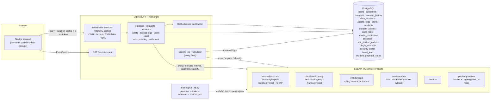

# DataGuard AI: technical reference

This page holds the detailed material for developers and reviewers. For the beginner-friendly
overview, start with the [main README](../README.md).

- [Features](#features)
- [Architecture](#architecture)
- [Quick start (Docker)](#quick-start-docker)
- [Running without Docker](#running-without-docker)
- [Live deployment on Vercel](#live-deployment-on-vercel)
- [Demo mode / Vercel](#demo-mode--vercel)
- [Accounts and the first admin](#accounts-and-the-first-admin)
- [Environment variables](#environment-variables)
- [Feature → code map](#feature--code-map)
- [ML methodology & evaluation](#ml-methodology--evaluation)
- [Cybersecurity module](#cybersecurity-module)
- [API reference](#api-reference)
- [Database schema](#database-schema)
- [Security & privacy design](#security--privacy-design)
- [Ethical considerations](#ethical-considerations)
- [Limitations](#limitations)
- [Future work](#future-work)
- [How this MVP was verified](#how-this-mvp-was-verified)

## Features

**Customer portal**
- View, grant and withdraw consent for each processing purpose, with a full consent history
- Submit access, correction and deletion requests and track them (reference number, status, target date, response)
- Privacy assistant: retrieval over the company policy docs. It answers with quoted passages and
  citations, and says *"not covered by policy"* when retrieval confidence is low

**Admin / DPO console**
- Dashboard KPIs, an anomaly trend chart, incidents by category and the latest flagged alerts
- Access-log anomaly alerts (Isolation Forest) with **per-event SHAP explanations**. Every alert
  starts as *flagged for review*, and only a person can mark it *confirmed* or *false positive*
- Incidents: an ML category suggestion (two models compared), assignment, status, severity, a
  human-confirmed category, notes and trackable corrective actions, plus a timeline
- Data-rights request handling. The response is shown to the customer; the internal note is not
- Risk analytics: daily counts, a 7-day rolling mean and a linear trend projected 14 days ahead with a band
- Model performance: precision, recall, F1, false-positive rate, ROC-AUC, confusion matrices, a
  comparison of the two classifiers and recall per anomaly pattern
- Audit-log viewer with **hash-chain verification**
- User and role management with a permission matrix; unlock and delete accounts
- **Security operations (security, DPO, admin):** SOC dashboard with posture score, sign-in threat
  monitoring with detection rules and a SAMPLE threat-intel list, MITRE ATT&CK badges, phishing
  detector, incident playbooks with the NPC 72-hour clock, and a security self-check of the site's headers

**Every account: My security**
- Optional TOTP MFA (QR code + 10 one-time backup codes), password change, active sessions with
  "sign out other sessions", and personal sign-in history
- Real-time alerts: the backend scores new access events as they arrive and pushes new alerts to
  the console over Server-Sent Events

## Architecture



The browser never calls the ML service directly. Every ML call goes through the backend, which
checks authentication and role first.

```
dataguard-ai/
├── data/            generate.py (synthetic data) · policies/*.md (sample policy docs)
├── db/              init.sql (schema, append-only trigger) · build_seed.py → seed.sql
├── ml-service/      app/ (FastAPI) · training/ (train + evaluate) · models/ (generated)
├── backend/         src/ (Express + TS: routes, lib/audit.ts, lib/mask.ts, jobs/scorer.ts)
├── frontend/        src/app (pages) · src/lib (api, demo store) · src/demo/fixtures.json
├── docker-compose.yml · .env.example
```

## Quick start (Docker)

```bash
cp .env.example .env        # change JWT_SECRET, set ADMIN_EMAIL to your e-mail
docker compose up --build
# open http://localhost:3000/signup and sign up with ADMIN_EMAIL -> you are the first admin
```

| Service | URL |
|---|---|
| Frontend | http://localhost:3000 |
| Backend API | http://localhost:4000/api/health |
| ML service (Swagger UI) | http://localhost:8000/docs |
| PostgreSQL | localhost:5432 (dataguard / dataguard) |

What happens when the stack starts:
- The ML image generates the synthetic data, then trains and evaluates the models during `docker build` (about 10 s). It also tries to cache the MiniLM embedding model.
- Postgres runs `db/init.sql`, `db/seed.sql`, then the migrations in `db/migrations/` (002 security tables, 003 synthetic sign-in history + SAMPLE threat intel, 004 removes the old demo logins). There are **no login accounts** afterwards. Seed timestamps are relative to load time, so the data always looks recent.
- The backend scores the roughly 1,900 seeded access events through the ML service, which creates about 100 alerts. It also classifies the seeded incidents. A simulator then adds a synthetic access event every 20 s (set `SIMULATE_ACCESS_LOGS=false` to turn it off).

To reset everything, run `docker compose down -v`.

## Running without Docker

You need Python 3.11+, Node 20+ and PostgreSQL 14+.

```bash
# 1) ML: data + training + API
cd ml-service
python -m venv .venv && . .venv/bin/activate
pip install --index-url https://download.pytorch.org/whl/cpu torch   # optional, smaller CPU build
pip install -r requirements.txt -r requirements-extras.txt   # extras: uvicorn, MiniLM+FAISS (optional)
python -m training.run_all          # runs data/generate.py, trains, writes models/metrics.json
uvicorn app.main:app --port 8000

# 2) Database
createuser dataguard -P   # password: dataguard
createdb -O dataguard dataguard
python ../db/build_seed.py          # optional: regenerate seed.sql from data/generated
psql -U dataguard -h localhost dataguard -f ../db/init.sql -f ../db/seed.sql
for f in ../db/migrations/00*.sql; do psql -U dataguard -h localhost dataguard -v ON_ERROR_STOP=1 -f "$f"; done

# 3) Backend
cd ../backend && npm install && npm run build && npm start      # :4000
npm run create-admin                                            # first admin (or use ADMIN_EMAIL + sign-up)

# 4) Frontend
cd ../frontend && npm install && npm run build && npm start      # :3000
```

Useful commands:
- `npm run verify-audit` (in backend/) recomputes the whole audit hash chain from the command line.
- `RAG_BACKEND=tfidf` forces the TF-IDF retriever, which needs no model download.

## Live deployment on Vercel

**Live app:** https://dataguard-ai-roan.vercel.app. This is the full stack, not demo mode. Customers sign up on `/signup`; staff accounts are created by an admin.

The root `vercel.json` deploys three [Vercel Services](https://vercel.com/docs/services) together as one atomic deployment:

| Service | Root | Runtime | Public route |
|---|---|---|---|
| `frontend` | `frontend/` | Next.js | `/*` |
| `backend` | `backend/` | Express as a Vercel Function (entrypoint `src/app.ts`) | `/api/*` |
| `ml` | `ml-service/` | FastAPI as a Python Function (entrypoint `app/main.py`) | **none.** It is private and reachable only through a service binding (`ML_SERVICE_URL`) from the backend. |

The database is **Neon Postgres** (Vercel Marketplace, free plan). The integration provides `DATABASE_URL`, the pooled connection with SSL. Schema and seed are the same `db/init.sql` and `db/seed.sql` used by Docker, followed by the additive migrations in `db/migrations/` (each is idempotent: `IF NOT EXISTS` / `ON CONFLICT`).

How the serverless deployment differs from `docker compose`:
- **Scoring.** There are no in-process timers. Events are scored immediately on `POST /api/access-logs/ingest` and on `POST /api/access-logs/simulate` (the *Simulate 5 events* button on *Access logs*). Anything left unscored is handled by `GET /api/cron/score`, which a daily Vercel Cron calls with `Authorization: Bearer $CRON_SECRET`. Security and admin users can also call it with their session.
- **Live alerts.** The browser polls `GET /api/alerts/latest` every 15 s (`NEXT_PUBLIC_ALERT_TRANSPORT=poll`) instead of using SSE. SSE remains the default for Docker.
- **ML service.** It is stateless. It loads the trained `models/*.joblib` artifacts that are bundled with the deployment, so train them before deploying (`python -m training.run_all`). The assistant uses TF-IDF retrieval (`RAG_BACKEND=tfidf`) over the policy documents copied to `ml-service/policies/`. Off-topic questions are refused. `sentence-transformers`, `faiss`, `torch` and `uvicorn` live in `requirements-extras.txt`, which only the Docker image installs. This keeps the Python function at about 250 MB.
- **Configuration.** `JWT_SECRET` (signs CSRF tokens, derives the MFA encryption key unless `MFA_ENC_KEY` is set) and `CRON_SECRET` are random secrets stored as Vercel environment variables. The backend refuses to start on Vercel without `JWT_SECRET`. `ADMIN_EMAIL` bootstraps the first admin. On Vercel, cookies are `Secure` with the `__Host-` prefix and `trust proxy` is on. Other settings: `NEXT_PUBLIC_API_URL=/` (same origin), `NEXT_PUBLIC_DEMO_MODE=false`, `SIMULATE_ACCESS_LOGS=false`.

Deploy from the repository root with an authenticated Vercel CLI:

```bash
vercel link              # once
vercel deploy --prod
```

Verify a deployment end-to-end, including logins, scoring, SHAP, review, assistant, audit chain and RBAC, with 1440px screenshots:

```bash
DG_ADMIN_EMAIL=you@example.com DG_ADMIN_PASSWORD='...' DG_ADMIN_TOTP_SECRET='...' \
  python scripts/verify_live.py https://dataguard-ai-roan.vercel.app screenshots/live
```

It signs up a throwaway customer (`verify.<timestamp>@example.com`, printed at the end; delete it
under *Users & roles*) and signs in with your admin. The TOTP secret is only needed if that admin uses MFA.

Plan notes: the Hobby plan limits crons to once per day and functions to 300 s. Neon's free plan auto-suspends when idle, so the first request after a pause takes about 1 s longer.

## Demo mode / Vercel

The frontend can run on its own using bundled fixtures. These are real outputs exported from the
running stack: anomaly scores with SHAP values, incident classifications, the risk forecast, model
metrics and pre-computed assistant answers with citations.

```bash
cd frontend
NEXT_PUBLIC_DEMO_MODE=true npm run build && npm start
```

How demo mode behaves:
- **Login:** a role picker replaces the login form.
- **Banner:** a yellow *"Demo mode, sample data"* banner is always visible.
- **Changes:** consent toggles, requests, reviews, incident edits and user changes are saved only in your browser (localStorage). They are still written to a client-side audit chain using the same SHA-256 algorithm, so *Verify hash chain* works.
- **Assistant:** it cannot run the embedding model in the browser. It matches your question to the closest pre-computed one and refuses when nothing is close enough.

**Static demo on Vercel:** create a project with Root Directory `frontend` and set `NEXT_PUBLIC_DEMO_MODE=true`. Nothing else is needed. The live deployment described above does **not** use demo mode.

## Accounts and the first admin

There are **no seeded login accounts and no shared password**. Migration `004_remove_demo_accounts.sql`
deletes the old `*@dataguard.demo` users (their audit history stays; references are set to NULL).

- **Customers** sign up at `/signup` (`POST /api/auth/signup`). Sign-up always creates a `customer`
  user plus a new customer record with every consent off. An e-mail that already belongs to a
  synthetic customer record or a user is refused with 409. Sign-ups are limited per IP per hour.
- **Staff can't self-register.** An admin creates staff under *Users & roles* (`POST /api/users`,
  roles dpo / security / admin / executive only). Customers can't be turned into staff or the reverse.
- **First admin**, two ways:
  1. `ADMIN_EMAIL=you@example.com`: while **no admin exists**, a sign-up with exactly that e-mail
     becomes `admin` (audited as `auth.bootstrap_admin`). After that the variable has no effect.
  2. `npm run create-admin [-- email]` in `backend/` (or `npm run create-admin:prod` from a build /
     `docker compose exec backend npm run create-admin:prod`). Asks for name and a hidden password,
     applies the same password policy, creates or promotes the user, and writes `user.create_admin_cli`
     to the audit log. Works with piped input too.
- **E-mail verification and password-reset e-mails are not implemented**: they need an e-mail
  provider, and none is available for free in this deployment. This is a known gap.
- **Demo mode** (frontend only, `NEXT_PUBLIC_DEMO_MODE=true`) still has a role picker. It has no
  credentials at all, because nothing leaves the browser.

## Environment variables

Backend (see `.env.example`):

| Variable | Default | Purpose |
|---|---|---|
| `DATABASE_URL` | local postgres | Postgres connection |
| `JWT_SECRET` | dev default (refused on Vercel) | HMAC key for CSRF tokens; MFA key derivation |
| `MFA_ENC_KEY` | derived from `JWT_SECRET` | Separate AES-256-GCM key for TOTP secrets at rest |
| `ADMIN_EMAIL` | empty | First-admin bootstrap via sign-up |
| `SESSION_HOURS` | 8 | Session lifetime (cookie and server row) |
| `LOCK_THRESHOLD` / `LOCK_MINUTES` | 5 / 10 | Account lockout after N consecutive failures |
| `LOGIN_IP_FAIL_LIMIT` | 20 | Max failed sign-ins per IP per 15 min (429 after) |
| `COOKIE_SECURE` | true on Vercel, else false | `Secure` + `__Host-` cookie prefix |
| `TRUST_PROXY` | `true` on Vercel, else `loopback` | Express trust proxy (so `X-Forwarded-For` can't be spoofed) |
| `CORS_ORIGIN` | `http://localhost:3000` | Allowed browser origins (comma-separated, credentials on) |
| `SELF_CHECK_URL` | this deployment | Comma-separated URLs the self-check may scan (allow-list, no SSRF) |
| `ML_SERVICE_URL`, `ALERT_THRESHOLD`, `SIMULATE_*`, `CRON_SECRET` | | as before |

Frontend: `NEXT_PUBLIC_API_URL` (`/` for same origin), `NEXT_PUBLIC_ALERT_TRANSPORT` (`poll` or SSE),
`NEXT_PUBLIC_DEMO_MODE`, and optional `API_PROXY_URL` (build-time rewrite of `/api/*` to a backend,
useful for local same-origin testing).

## Feature → code map

| Feature | Where |
|---|---|
| Synthetic data (customers, consents, access logs with labelled anomalies, incident texts) | `data/generate.py` |
| Sample privacy policies | `data/policies/*.md` |
| Schema (11 tables) + append-only trigger | `db/init.sql` |
| Seed (demo users with bcrypt hashes, recent logs, incidents, requests) | `db/build_seed.py` → `db/seed.sql` |
| Sessions, CSRF, lockout, RBAC guards | `backend/src/routes/auth.ts`, `backend/src/lib/auth.ts` |
| Password policy (zxcvbn ≥ 3, 12+ chars) | `backend/src/lib/password.ts`, `frontend/src/components/security.tsx` |
| TOTP MFA + backup codes, AES-GCM at rest | `backend/src/lib/totp.ts`, `backend/src/lib/crypto.ts`, `frontend/src/components/MySecurity.tsx` |
| Sign-up + first-admin bootstrap | `POST /api/auth/signup`, `backend/src/scripts/createAdmin.ts`, `frontend/src/app/signup` |
| Detection rules + SAMPLE threat intel | `backend/src/lib/detect.ts`, `db/build_security_seed.py` → `db/migrations/003_security_seed.sql` |
| SOC dashboard, threats, feed, simulator | `backend/src/routes/soc.ts`, `frontend/src/app/admin/soc`, `frontend/src/app/admin/threats` |
| Phishing detector | `ml-service/training/train_phishing.py`, `ml-service/app/phishing_features.py`, `backend/src/routes/phishing.ts`, `frontend/src/app/admin/phishing` |
| IR playbooks + NPC 72-h clock | `backend/src/lib/playbooks.ts`, `backend/src/routes/incidents.ts`, `frontend/src/components/Playbook.tsx` |
| ATT&CK mapping | `frontend/src/lib/attack.ts` |
| Security self-check | `backend/src/routes/selfcheck.ts`, `frontend/src/app/admin/self-check` |
| Security headers / CSP | `backend/src/app.ts` (helmet), `frontend/src/proxy.ts` (per-request nonce CSP) |
| Consents + history | `backend/src/routes/consents.ts`, `frontend/src/app/portal/consents` |
| Data-rights requests (customer + DPO) | `backend/src/routes/requests.ts`, `frontend/src/app/portal/requests`, `frontend/src/app/admin/requests` |
| Privacy assistant (RAG, citations, refusal) | `ml-service/app/rag.py`, `frontend/src/app/portal/assistant` |
| Access-log scoring job, alert creation, simulator | `backend/src/jobs/scorer.ts` |
| Ingestion endpoint (score on arrival) | `POST /api/access-logs/ingest` in `backend/src/routes/accessLogs.ts` |
| Real-time alert push (SSE) | `backend/src/routes/alerts.ts` (`/stream`), `frontend/src/components/AppShell.tsx` |
| Human review of alerts | `PATCH /api/alerts/:id/review`, `frontend/src/app/admin/alerts/[id]` |
| Isolation Forest + SHAP | `ml-service/training/train_anomaly.py`, `ml-service/app/main.py` |
| Shared feature engineering | `ml-service/app/features.py` |
| Incident classifiers (LogReg vs RF) | `ml-service/training/train_incidents.py` |
| Incidents: assignment, status, notes, corrective actions | `backend/src/routes/incidents.ts`, `frontend/src/app/admin/incidents/[id]` |
| Risk trend | `ml-service/app/forecast.py`, `backend/src/routes/analytics.ts`, `frontend/src/app/admin/risk` |
| Model metrics | `ml-service/models/metrics.json` (generated), `frontend/src/app/admin/models` |
| Hash-chained audit log + verification | `backend/src/lib/audit.ts`, `backend/src/routes/audit.ts`, `frontend/src/app/admin/audit` |
| PII masking in logs and audit details | `backend/src/lib/mask.ts` |
| Data minimization in customer responses | explicit column lists in `consents.ts` / `requests.ts` |
| Users & roles | `backend/src/routes/users.ts`, `frontend/src/app/admin/users` |
| Demo mode | `frontend/src/lib/demo.ts`, `frontend/src/demo/fixtures.json`, `frontend/scripts/export-demo-fixtures.mjs` |

## ML methodology & evaluation

From `ml-service/`, run `python -m training.run_all` to reproduce these numbers. The seed is fixed at 42 and
`models/metrics.json` is regenerated on each run. **All numbers are on synthetic data.**

### 1. Access-log anomaly detection: Isolation Forest

- **Features** (`app/features.py`):
  - hour of day, records accessed, distinct customers, off-hours flag, weekend flag, export flag, failed logins
  - log(records), the distinct-customer ratio, and one-hot employee role
- **Training:** unsupervised. The `is_anomaly` labels are **never** used for fitting.
  - `IsolationForest(n_estimators=300, contamination=0.05)`
- **Split:** chronological. The first 60 days are used for fitting (5,473 events) and the last 30 days for evaluation (2,718 events, 4.7 % injected anomalies).
- **Score:** the risk score is `sigmoid(-decision_function / std)`, so 0.5 is the model's own boundary. The alert threshold is configurable with `ALERT_THRESHOLD`.
- **Explanations:** `shap.TreeExplainer` on the forest, with the sign flipped so that a positive value means "pushed toward anomalous".

| Metric | Value |
|---|---|
| Precision | **0.790** |
| Recall | **0.890** |
| F1 | **0.837** |
| False-positive rate | **0.0116** (30 of 2,591 normal events) |
| ROC-AUC | 0.996 |
| Average precision | 0.928 |
| Confusion matrix | TN 2561 · FP 30 · FN 14 · TP 113 |

Recall for each injected pattern:

| Pattern | Recall |
|---|---|
| bulk_export_offhours | 1.00 |
| credential_misuse | 1.00 |
| slow_exfiltration | 0.92 |
| mass_lookup | 0.87 |
| role_mismatch | 0.72 |

Role-mismatch events are the hardest. The model has no notion of *which role should be allowed to see which data*.

**Why these numbers are optimistic:** the anomalies were injected by the same generator that
defines "normal". Real insider misuse is rarer, more varied and often looks like normal work.

### 2. Incident report classification: TF-IDF + two models

- **Data:** 900 synthetic reports across 6 categories:
  - unauthorized_access, data_leak, phishing, misconfiguration, policy_violation, lost_device
- **Realism:** about 35 % of reports mix in a sentence from another category, and **4 % label noise** is
  injected on purpose so the task isn't trivial.
- **Features:** TF-IDF on 1–2 word n-grams (sublinear TF, English stop-words).
- **Evaluation:** a stratified 80/20 split (720 train, 180 test), plus 5-fold CV on the training part.

| Model | Accuracy | Macro P | Macro R | Macro F1 | 5-fold CV macro-F1 |
|---|---|---|---|---|---|
| Logistic Regression (C=5) | 0.844 | 0.855 | 0.842 | 0.844 | 0.826 ± 0.037 |
| Random Forest (300 trees) | **0.850** | 0.853 | 0.845 | **0.847** | 0.818 ± 0.036 |

Both models score about the same: the test gap is smaller than the CV standard deviation. Random
Forest is selected for serving by test macro-F1. The UI shows both models' top-3 predictions and
whether they agree. The suggestion is only advisory, and a reviewer sets the confirmed category.

### 3. Risk trend analysis

- **Data:** daily counts of alerts that are not false positives, or of incidents, built from the database.
- **Method:** a 7-day rolling mean, plus an OLS line fitted to the last 30 days and projected 14 days ahead.
  The band is ±1.96 × the residual standard deviation.
- **Trend level:** a transparent rule on the slope and the change against the baseline gives *stable*, *elevated* or *high*.
- **Purpose:** this is simple trend analysis for planning, not a forecasting model.

### 4. Privacy assistant: retrieval-grounded answers

- **Indexing:** the policy docs are split into one chunk per `##` section (23 chunks).
- **Retrieval:**
  - Primary: `all-MiniLM-L6-v2` embeddings with a FAISS `IndexFlatIP` (cosine similarity).
  - Re-ranking: candidates are re-ranked by `0.75·cosine + 0.25·tfidf`.
  - Fallback: TF-IDF retrieval is used automatically if the model or FAISS can't be loaded, or when `RAG_BACKEND=tfidf`.
- **Answer:** the default is **extractive**. It quotes the best passage, adds a second one if it is
  nearly as relevant, and returns all citations with document, section and score.
- **Optional LLM summary:** if `OPENAI_API_KEY` is set, an LLM is asked to summarize **only** the
  retrieved passages. Any failure falls back to the extractive answer.
- **Refusal:** if the best cosine similarity is below 0.40 (or 0.12 for TF-IDF), the assistant answers
  *"not covered by policy"* and returns no citations.
- **Spot checks:** these are informal checks, not a benchmark.
  - In-scope questions about consent, retention, deletion, sharing, the DPO and breaches scored 0.52–0.76 and were answered from the right section.
  - Off-topic questions ("best pizza in Makati", "weather tomorrow") scored 0.03–0.08 and were refused.

## Cybersecurity module

### Authentication hardening
- **Sessions:** a random 256-bit session id in an `HttpOnly; SameSite=Strict; Path=/` cookie (`__Host-dg_session`
  with `Secure` on HTTPS). Only its SHA-256 is stored in `sessions`, with user agent, masked IP, MFA flag,
  `last_seen_at` and `revoked_at`. Logout, password change, "sign out other sessions" and disabling a user revoke rows.
- **CSRF:** unsafe methods need `x-csrf-token = HMAC(JWT_SECRET, "csrf:" + session id)`, returned in the JSON of
  login / me / sign-up and kept in memory by the frontend. Browser requests with a foreign `Origin` are also rejected.
- **Passwords:** bcrypt cost 12; 12–128 characters and zxcvbn score ≥ 3 (user inputs such as name and e-mail
  are penalised). The same check runs in the browser (meter) and on the server.
- **Lockout and rate limit:** 5 consecutive failures lock the account for 10 minutes (HTTP 423; admins can unlock).
  More than 20 failures per (masked) IP in 15 minutes → HTTP 429. Unknown e-mails run a dummy bcrypt compare so
  timing doesn't reveal which accounts exist. *Trade-off:* the 423 message itself reveals that a locked account exists.
- **MFA:** RFC 6238 TOTP (SHA-1, 30 s, 6 digits, ±1 step drift, replay of a used step refused). The secret is
  AES-256-GCM encrypted at rest. Login with MFA returns a short-lived `mfa_token`; `POST /api/auth/mfa/verify`
  accepts a TOTP or one of 10 single-use backup codes (stored as SHA-256). Disabling MFA or regenerating codes
  needs the password plus a current code.
- **Headers:** helmet on the API (`default-src 'none'`, no framing). The Next.js proxy (`src/proxy.ts`) sets a
  per-request nonce CSP: `script-src 'self' 'nonce-…' 'strict-dynamic'`, `style-src 'self' 'unsafe-inline'`
  (inline style attributes in charts), `img-src 'self' data: blob:`, `connect-src 'self'` (+ API origin),
  `frame-ancestors 'none'`, `object-src 'none'`, `base-uri 'self'`, `form-action 'self'`, plus HSTS (HTTPS only),
  `X-Frame-Options: DENY`, `nosniff`, `Referrer-Policy`, `Permissions-Policy` and COOP. Because the nonce changes
  per request, every page is rendered dynamically.

### Detection rules (every sign-in attempt is stored in `login_attempts` with a masked IP)

| Rule | Condition | ATT&CK | Severity |
|---|---|---|---|
| `brute_force` | ≥ 5 failures for one account in 10 min | T1110.001 Password Guessing | high (critical if the IP is listed) |
| `password_spraying` | ≥ 5 different accounts failing from one IP in 10 min | T1110.003 Password Spraying | high |
| `threat_intel_match` | IP on the SAMPLE threat-intel list | T1078 (success) / T1110 (failure) | critical / medium |
| `impossible_travel` | > 900 km/h between two successful sign-ins | T1078 Valid Accounts | high |
| `new_device` | first success from an unseen browser fingerprint | T1078 Valid Accounts | low |
| `account_lockout` | account locked | T1110 Brute Force | medium |

Alerts are de-duplicated per rule/account/IP for a short window and reviewed by a person
(`flagged_for_review` → `confirmed` or `false_positive`, audited). The **threat-intel list is SAMPLE
data** made of RFC 5737 documentation-only addresses (192.0.2.0/24, 198.51.100.0/24, 203.0.113.0/24), and the
"locations" of sign-ins are approximate placeholders; there is no real geolocation database. Anomaly
(access-log) alerts map to T1213 Data from Information Repositories, plus T1567 Exfiltration Over Web
Service when data was exported. Incident categories map to: phishing T1566, unauthorized access T1078,
data leak T1567, misconfiguration T1530, policy violation T1213, lost device (no technique).

### SOC posture score
Weighted average (0–100, grade A ≥ 90 … F < 60) of transparent checks, each with a tip on the page:
staff accounts with MFA (25), alerts reviewed in 30 days (20), no open high/critical security alerts (20),
audit hash chain intact (15), no accounts currently locked (10), no sign-ins from listed IPs in 24 h (10).

### Phishing detector
`ml-service/training/train_phishing.py` (seed 7, called by `run_all`). URL model: character 3–5-gram TF-IDF +
14 URL features → Logistic Regression. E-mail model: word 1–2-gram TF-IDF + 6 text features → Logistic
Regression. Explanations = coefficient × feature value. 3 % label noise and ambiguous hard cases are injected.

| Model | Precision | Recall | F1 | ROC AUC | Confusion (TN/FP/FN/TP) | Train / test |
|---|---|---|---|---|---|---|
| URL | 0.965 | 0.936 | 0.951 | 0.958 | 481 / 17 / 32 / 470 | 3,000 / 1,000 |
| E-mail | 0.968 | 0.957 | 0.963 | 0.970 | 363 / 12 / 16 / 359 | 2,250 / 750 |

**Honest caveat:** all examples are synthetic and the same templates appear in train and test, so the scores
measure recognition of these patterns, not generalisation to new campaigns. No real corpus is used.

### Incident response playbooks and the NPC clock
Each incident category has a 4-phase playbook (contain, eradicate, recover, lessons learned) defined in
`backend/src/lib/playbooks.ts`. Ticking a step stores who and when in `incident_playbook_steps` and writes
`incident.playbook_step` to the audit log. Marking an incident as a **personal-data breach** sets
`breach_discovered_at`; the UI counts down 72 hours (NPC Circular 16-03, Sec. 17(A)) and records when the NPC
was notified. This is a teaching aid, not legal advice.

### Security self-check
`POST /api/security/self-check` (REVIEWERS) scans an **allow-listed** URL (`SELF_CHECK_URL`, defaults to this
deployment) and grades: HTTPS/TLS version, certificate expiry, HTTP→HTTPS redirect, HSTS, CSP, clickjacking
protection, `X-Content-Type-Options`, `Referrer-Policy`, `Permissions-Policy`, COOP, no `X-Powered-By`,
session-cookie flags (via `/api/security/cookie-probe`) and API lock-down headers.

## API reference

All backend routes are under `/api` and are implemented in `backend/src/routes/`. Every route except
`/api/health`, `/api/auth/signup|login|mfa/verify`, `/api/security/cookie-probe` and `/api/cron/*` needs the
session cookie; state-changing requests also need the `x-csrf-token` header. Role groups
are defined in `backend/src/lib/auth.ts`:
- **STAFF:** dpo, security, admin, executive
- **REVIEWERS:** dpo, security, admin

| Method & path | Who | Purpose |
|---|---|---|
| `GET /api/health` | public | Liveness, DB check and runtime (`server` or `vercel`) |
| `POST /api/auth/signup` | public | Create a customer account (or the first admin if `ADMIN_EMAIL` matches and no admin exists) |
| `POST /api/auth/login` | public | E-mail + password → session cookie + `csrfToken`, or `{mfa_required, mfa_token}` |
| `POST /api/auth/mfa/verify` | public (with `mfa_token`) | TOTP or backup code → session |
| `GET /api/auth/me` · `POST /api/auth/logout` | any signed-in user | Current user + CSRF token; sign out |
| `GET /api/auth/sessions` · `DELETE /api/auth/sessions/:id` · `POST /api/auth/sessions/revoke-others` | any signed-in user | Own sessions |
| `GET /api/auth/login-history` · `POST /api/auth/password` | any signed-in user | Own sign-in attempts; change password |
| `GET /api/auth/mfa` · `POST /api/auth/mfa/setup|enable|disable|backup-codes` | any signed-in user | MFA management |
| `GET /api/soc/overview` · `GET /api/soc/feed` | REVIEWERS | SOC stats, posture, chart, top accounts/IPs, live feed |
| `GET /api/soc/security-alerts` · `PATCH /api/soc/security-alerts/:id/review` | REVIEWERS | Sign-in security alerts and their review |
| `GET /api/soc/login-attempts` · `GET /api/soc/threat-intel` | REVIEWERS | Sign-in attempts (filterable) and the SAMPLE threat-intel list |
| `POST /api/soc/simulate/brute-force` | security, admin | Insert a synthetic brute-force burst and run the rules |
| `POST /api/phishing/analyze` | REVIEWERS | Phishing probability + top signals for a URL or e-mail |
| `GET /api/security/self-check/targets` · `POST /api/security/self-check` | REVIEWERS | Header / TLS / cookie self-check |
| `GET /api/incidents/:id/playbook` · `PUT /api/incidents/:id/playbook/:key` | STAFF / REVIEWERS | Playbook steps (audited) |
| `PATCH /api/incidents/:id/breach` | REVIEWERS | Personal-data breach flag, NPC notified time |
| `GET /api/consents/me` · `GET /api/consents/me/history` · `PUT /api/consents/me/:purpose` | customer | View and change own consents |
| `GET /api/requests/me` · `POST /api/requests` | customer | Own data-rights requests |
| `GET /api/requests` · `PATCH /api/requests/:id` | dpo, admin | Handle data-rights requests |
| `GET /api/incidents` · `GET /api/incidents/:id` | STAFF | List and view incidents |
| `POST /api/incidents` · `PATCH /api/incidents/:id` | REVIEWERS | Create (with ML category suggestion) and update incidents |
| `POST /api/incidents/:id/actions` · `PATCH /api/incidents/:id/actions/:aid` | REVIEWERS | Corrective actions |
| `GET /api/alerts` · `GET /api/alerts/:id` | REVIEWERS + executive | Anomaly alerts with SHAP explanation |
| `GET /api/alerts/latest` | REVIEWERS + executive | Newest alert id and pending count (used for polling) |
| `GET /api/alerts/stream` | REVIEWERS + executive | Server-Sent Events stream of new alerts (Docker/local) |
| `PATCH /api/alerts/:id/review` | REVIEWERS | Human review: `confirmed`, `false_positive` or `flagged_for_review` |
| `GET /api/access-logs` | REVIEWERS | Recent access events with risk scores |
| `POST /api/access-logs/ingest` | security, admin | Ingest access events and score them immediately |
| `POST /api/access-logs/simulate` | REVIEWERS | Insert 1–20 synthetic events and score them now |
| `GET /api/audit-logs` · `GET /api/audit-logs/verify` | dpo, security, admin | Audit log and hash-chain verification |
| `GET /api/users/staff` | REVIEWERS | Staff list (for assignment) |
| `GET /api/users` · `POST /api/users` · `PATCH /api/users/:id` · `POST /api/users/:id/unlock` · `DELETE /api/users/:id` | admin | User and role management (staff creation, unlock, delete) |
| `GET /api/dashboard/kpis` · `GET /api/risk/forecast` · `GET /api/metrics` | STAFF | Dashboard KPIs, risk trend, model metrics |
| `POST /api/ml/classify` | STAFF | Classify an incident text |
| `POST /api/assistant/ask` | any signed-in user | Privacy assistant |
| `GET/POST /api/cron/score` | `CRON_SECRET` bearer, or security/admin session | Score pending events and classify pending incidents |

The ML service (`ml-service/app/main.py`) is internal: `GET /health`, `POST /anomaly/score`,
`POST /anomaly/explain`, `POST /incidents/classify`, `GET|POST /risk/forecast`, `POST /assistant/ask`,
`GET /metrics`, `POST /phishing/analyze`. Run it locally and open http://localhost:8000/docs for the interactive Swagger UI.

## Database schema

Defined in `db/init.sql` (11 tables) plus `db/migrations/002_security.sql` (6 more tables, new columns):

| Table | Holds |
|---|---|
| `customers` | Fictional customers of Acme Retail PH |
| `users` | Login accounts (customers and staff), bcrypt password hashes, roles |
| `consents` | Current consent per customer and purpose |
| `consent_history` | Every consent change |
| `data_requests` | Access, correction and deletion requests |
| `access_logs` | Employee access events, with risk score once scored |
| `alerts` | Events flagged for human review, with SHAP explanation and review status |
| `incidents` | Incident reports, ML-predicted and human-confirmed category |
| `incident_actions` | Corrective actions per incident |
| `audit_logs` | Hash-chained audit trail (a trigger blocks UPDATE and DELETE) |
| `model_predictions` | Stored model outputs |
| `sessions` | Server-side sessions (hashed id, user agent, masked IP, MFA flag, revoked time) |
| `mfa_backup_codes` | SHA-256 of single-use backup codes |
| `login_attempts` | Every sign-in attempt: e-mail, success, reason, masked IP, location, user agent, `synthetic` flag |
| `security_alerts` | Rule hits with ATT&CK technique, severity, review status |
| `threat_intel` | SAMPLE indicators (documentation IP ranges) |
| `incident_playbook_steps` | Who completed which playbook step and when |

Migration 002 also adds `users.mfa_enabled / mfa_secret_enc / mfa_last_step / failed_login_count / locked_until /
password_changed_at` and `incidents.personal_data_breach / breach_discovered_at / npc_notified_at`. Migration 003
loads 14 days of synthetic sign-in history and the sample threat intel; 004 removes the old demo logins.
All migrations are additive and idempotent: no existing data is dropped.

## Security & privacy design

- **Passwords and sessions:** bcrypt (cost 12), zxcvbn policy, server-side revocable sessions in an httpOnly cookie, CSRF tokens, lockout, optional TOTP MFA. Details in [Cybersecurity module](#cybersecurity-module).
- **Access control:** RBAC is enforced on every route on the server. The UI hides links too, but that is only for convenience.
- **Hash-chained audit log:** every mutating action writes an audit row (logins and failed logins included). Each row stores
  `hash = sha256(prev_hash + canonical_json(created_at, actor, action, entity, details))`.
  - Writes are serialized with a Postgres advisory lock so the chain can't fork.
  - A DB trigger blocks UPDATE and DELETE on `audit_logs`.
  - Editing a row directly as a superuser **is detected** by `GET /api/audit-logs/verify`. This was tested by changing one row's details, and verification reported the exact row.
- **Data minimization:**
  - Customer endpoints select explicit columns only. `handled_by` and `internal_note` are never returned to customers.
  - Employees appear as pseudonymous IDs in the alert views.
- **PII masking:**
  - The request logger records only method, path and status (no bodies or query strings).
  - `safeLog()` masks emails (`j***@example.ph`), PH mobile numbers and JWTs.
  - IP addresses are stored masked (IPv4 /24, IPv6 /48).
  - Audit `details` pass through the same masker, which also redacts keys such as `email`, `password` and `phone`.

## Ethical considerations

- **Alerts are not accusations.**
  - Every model flag starts as *flagged for review*, and nothing is decided automatically.
  - The SHAP view explains *what the model reacted to*, not intent.
  - The UI reminds reviewers to check context the model can't see, such as approved tickets and scheduled jobs.
- **Feedback loop.** Reviewer decisions (confirmed or false positive) are stored, so precision on real
  alerts can be measured and the threshold tuned. False positives are excluded from the risk trend.
- **Employee monitoring is itself processing of personal data.** A real deployment needs:
  - a lawful basis
  - a clear notice to staff
  - proportionality and retention limits for access logs
  - restricted access to the console
- **Bias.** A role-based feature can make some roles, such as analysts with naturally high volumes,
  look riskier or safer. Check error rates per role before relying on scores.
- **The assistant is not legal advice.** It quotes the company's own documents and refuses when they
  don't cover a question, rather than inventing an answer.

## Limitations

- **Synthetic data:** the metrics reflect the generator's assumptions. Real logs would need
  re-engineered features, retraining and proper validation.
- **Static models:** Isolation Forest has a fixed contamination prior. Nothing retrains or detects drift yet.
- **Simple trend analysis:** the trend is a linear fit, so it does not model seasonality.
- **Small policy set:** the RAG corpus is 5 short documents, and the similarity thresholds were tuned by hand on a few questions.
- **Auth gaps:** no e-mail verification or password-reset e-mail (no free e-mail provider); a locked account's
  423 response reveals that it exists; the per-IP limit uses masked IPs (a /24 shares one budget).
- **CSP:** `style-src` still allows `'unsafe-inline'` for inline style attributes.
- **Threat intel and geolocation are samples**, and the phishing models are trained on synthetic templates only.
- **Audit chain limits:** the hash chain detects tampering but can't stop a DB superuser from rewriting the whole chain. Anchoring the latest hash outside the database would close that gap.
- **Only partly fulfilled requests:** the data-rights workflow tracks status but doesn't export or delete data automatically.
- **Weekday drift:** seed timestamps are shifted to look recent, so the stored `is_weekend` feature may not match the shifted calendar day.
- **Few automated tests:** verification was done with scripted API calls and browser runs, described below. There are no unit tests yet.
- **Demo mode limits:** it uses a fixed snapshot. New incidents created in demo mode get no ML classification, and the assistant only knows the pre-computed questions.

## Future work

- **Model work:** feedback-driven threshold tuning and periodic retraining. Per-employee baselines (peer-group models), and
  supervised models once enough reviewed alerts exist.
- **Security:** e-mail verification and reset, WebAuthn passkeys, a real threat-intel feed and GeoIP, and audit-hash anchoring to object storage or a timestamping service.
- **Data-rights automation:** generate access exports and run deletion or anonymization jobs.
- **Workflows:** a DPO reporting export and an NPC notification template.
- **Testing:** unit and integration tests in CI (Jest for the API, pytest for ML, Playwright for the UI).
- **Assistant:** a larger, versioned policy corpus with a proper retrieval evaluation set.

## How this MVP was verified

Everything below was run on the development machine. Docker networking needed the host's
iptables to be switched to legacy mode in that sandbox; that is a property of that machine, not of the project.

- **Data and training:**
  - `python data/generate.py` and `python -m training.run_all` produced the metrics above.
  - The Docker build reproduced the same metrics.
- **ML service:** every endpoint was tested with curl (`/health`, `/anomaly/score`, `/anomaly/explain`,
  `/incidents/classify`, `/risk/forecast` GET and POST, `/assistant/ask` including refusals, `/metrics`).
  The TF-IDF fallback was tested with `RAG_BACKEND=tfidf`.
- **Backend:**
  - It type-checks and builds.
  - Login, consents, requests, alert review, incident create/update/actions, user management and SSE were exercised against PostgreSQL 17.
  - RBAC denials were checked: an executive cannot review alerts or list users; a customer cannot read incidents; a request with no token is rejected.
  - The audit chain verified as valid, and a manual edit was detected.
- **Frontend:** `next build` passes in both live and demo mode.
- **End to end:** Playwright drove the browser against the native stack and again against the Docker stack:
  - login (a wrong password is rejected), the dashboard and model metrics
  - alert review, then opening an incident from that alert (ML classification shown)
  - audit verification, a customer consent toggle and an assistant answer
  - a customer being redirected away from `/admin`
- **Full Docker run:** `docker compose up --build` brought up all 4 services. They became healthy and passed the same browser test.

**Cybersecurity module (native stack: PostgreSQL 17, ML service, backend, `next start`).** Docker was not
available on that machine, so the compose file was checked by parsing it and by applying
init → seed → 002 → 003 → 004 to a fresh database (0 users afterwards). A scripted API run passed 43/43 checks:
the old demo password is rejected; weak passwords are rejected; `ADMIN_EMAIL` sign-up becomes admin; the cookie is
HttpOnly + SameSite=Strict; duplicate and synthetic-customer e-mails get 409; RBAC 401/403; missing CSRF and a
foreign Origin get 403; admin creates staff but not customers; MFA setup/enable, login challenge, wrong and right
codes; lockout on the 5th failure and unlock; sessions list and revoke-others; SOC overview; the simulated brute
force raises a critical T1110.001 alert; threat intel; phishing scores; playbook tick; NPC deadline; audit chain
valid; self-check. `npm run create-admin` was tested piped and in a pseudo-terminal (password not echoed), and
`scripts/verify_live.py` passed 13/13 against the local stack. Screenshots were taken with Playwright at 1440 px.
